# CAMPUS MEMORY — System Architecture Design Document

| Field | Value |
|---|---|
| **Project** | CAMPUS MEMORY — Temporal Campus Event-Provenance Database |
| **Course** | Database Systems — 24CS520 |
| **Document** | `CAMPUS_MEMORY_Architecture_Design_v1.0.md` |
| **Version / status** | v1.0 — Proposed architecture; not yet approved or implemented |
| **Planning baseline** | `CAMPUS_MEMORY_Planning_Document_v0.2.md` |
| **Date** | 1 November 2026 |
| **Team size** | 4 members |
| **Selected stack** | React → Python/FastAPI → PostgreSQL hosted on Supabase; Git + GitHub |

> **Important status notice:** This architecture is based on Planning Document v0.2 and the architecture brief supplied by the team. The original CAMPUS MEMORY Project Overview and official 24CS520 guideline were not available in the source workspace when v0.2 was prepared. PostgreSQL/Supabase faculty approval remains **NOT CONFIRMED** (D-01). All architecture choices described as proposed or pending require team review. No component described here is claimed to have been implemented or tested.

---

## 1. Document Overview

### 1.1 Purpose

This document describes the proposed software architecture for CAMPUS MEMORY. It defines the responsibilities and interactions of the React frontend, Python/FastAPI backend, and Supabase-hosted PostgreSQL database. It also describes API boundaries, security, authentication options, database connectivity, deployment, development workflow, and architecture decisions.

It is the technical blueprint for the separate Database Schema Document and subsequent application implementation. It intentionally does **not** define final database tables, columns, SQL DDL, triggers, procedures, or application source code. Those belong in the Database Schema Document and implementation repository.

### 1.2 Intended audience

- The four student team members.
- The project lead and project guide/faculty reviewer.
- Anyone reviewing or maintaining the project implementation.

### 1.3 Source material and limitations

| Source | Use in this document | Status |
|---|---|---|
| `CAMPUS_MEMORY_Planning_Document_v0.2.md` | Project concept, scope, roles, FR/NFR identifiers, pending decisions D-01 to D-22, proposed database logic | Team planning baseline; academic details remain unverified |
| Architecture task brief supplied by the team | Required architecture topics, diagrams, API catalogue and decision records | Used as the architecture-document specification |
| Official CAMPUS MEMORY Project Overview | Would be used to cross-check concept and features | Not available in the source material reviewed |
| Official 24CS520 DBMS Mini Project Guidelines | Would be used to verify academic requirements and accepted DBMS | Not available in the source material reviewed |
| Official technical documentation | Used for current architectural/technical facts and constraints | Links listed in Section 19; checked 1 November 2026 |

This document does not add official faculty requirements, approvals, marks, deadlines, or deliverable interpretations. It preserves the pending items in v0.2, especially D-01 (DBMS approval), D-05 (authentication), D-06 (Supabase services/API exposure), D-07 (database connection mode), D-09 (deployment), D-18 (evidence enforcement), and D-22 (trigger identity context).

### 1.4 Status notation

| Tag | Meaning |
|---|---|
| **[C] Team decision** | Selected by the team; not a faculty approval |
| **[A] Proposed architecture** | Recommended design to be reviewed by the team |
| **[D] Pending decision** | Requires team or faculty confirmation |
| **[U] Unverified academic item** | Must be checked against the official 24CS520 guideline |

### 1.5 Scope

**Included:** logical architecture; component responsibilities; interaction diagrams; frontend and backend organization; API catalogue; database connectivity options; authentication and authorization options; security controls; deployment approach; migration workflow; architecture decision records; traceability to v0.2 requirements.

**Excluded:** final relational schema, table/column definitions, SQL scripts, actual trigger/procedure implementation, React code, FastAPI code, production infrastructure provisioning, and claims of completed tests.

---

## 2. Architecture Overview

### 2.1 System purpose

CAMPUS MEMORY records Campus Events across technical, infrastructure, academic, and operational categories. It links events through directed cause-to-effect relationships only when people have entered and assessed the connection. Each relationship has a status, confidence, explanation, and supporting evidence. The system investigates recorded upstream causes, downstream effects, impacts, and selected historical status information.

The worked example is:

**UPS failure → Network switch failure → Lab network outage → Lab session cancellation.**

The system must not infer causation solely from time proximity (FR-017). A relationship can be suspected while evidence is incomplete; confirmation requires evidence under the proposed database rules in v0.2 (FR-012, FR-047, FR-048).

### 2.2 Selected three-layer architecture

**[C]** The team-selected architecture is:

1. **Presentation layer — React:** renders screens, forms, reports, search and investigation results. It communicates with the FastAPI API over HTTPS.
2. **Application layer — Python/FastAPI:** authenticates requests, checks roles, validates input, orchestrates use cases, manages transactions, and executes parameterized SQL or database procedures.
3. **Data layer — Supabase-hosted PostgreSQL:** stores relational data, enforces constraints, runs views, trigger functions/triggers and stored procedures, and executes recursive investigation queries.

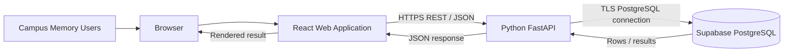

### 2.3 Why this architecture is suitable

- It gives each layer a focused responsibility and avoids database code being scattered through UI components.
- It keeps SQL and required academic database objects demonstrable directly in PostgreSQL, rather than simulating them in Python (v0.2 Sections 8.8 and 10.6).
- FastAPI provides a clear REST boundary between React and PostgreSQL.
- PostgreSQL supports relational integrity, transactions, views, triggers, procedures and recursive common table expressions needed by the proposed data model and graph traversals.
- A separate database access layer makes it possible to change connection settings without rewriting UI code.
- Git-managed migration scripts can provide a reproducible database build process.

### 2.4 Browser-to-database boundary

The selected application-data path is **React → FastAPI → PostgreSQL**. The browser must not receive a PostgreSQL connection string, database password, backend secret, or Supabase service-role/secret key. React sends application requests to FastAPI; FastAPI verifies the caller and accesses PostgreSQL using backend-only credentials.

Supabase Auth, if selected, is a separate identity service. The browser may communicate with Supabase Auth endpoints for sign-in/session operations using a browser-safe publishable key; that does **not** authorize the browser to call the PostgreSQL Data API for application data. Application data requests remain routed through FastAPI. See Sections 9 and 12.

---

## 3. Architecture Goals and Principles

| Principle | Meaning for CAMPUS MEMORY | Design consequence |
|---|---|---|
| Separation of concerns | UI, application rules and persistence should not be mixed together | React components call API clients; FastAPI services coordinate use cases; PostgreSQL owns relational integrity and database objects |
| Database-centric academic work | Required SQL, views, triggers and procedures must be real database objects | All such scripts are stored in Git and can be demonstrated in a SQL client / Supabase SQL Editor |
| Data integrity | Invalid or inconsistent relationships should be rejected at the database boundary | Use PK/FK, UNIQUE, CHECK, NOT NULL and database triggers where appropriate; API validation alone is insufficient |
| Security by boundary | A user must not bypass backend permissions by calling a hidden UI route or a data API | Authenticate and authorize every protected FastAPI request; restrict direct table access and optional Supabase Data API exposure |
| Least privilege | Each application identity should receive only the access required | Use a dedicated database role for the backend rather than an administrative database owner for normal application queries |
| Provenance | A causal relationship must show who recorded it, when, why, and what evidence supports it | Relationship writes are attributed to the authenticated backend identity; evidence and history are persisted separately |
| Auditability | Important status changes must remain traceable | TG-1 is intended to record initial and changed event statuses; general field-level audit remains future/pending (FR-050, D-15) |
| Maintainability | Four students must understand and change the project safely | Use small modules, readable SQL, stable API contracts, version-controlled migrations, code review and a README |
| Reusability | Common validation, authorization and UI patterns should be shared | Shared React components, Pydantic schemas, backend dependencies and service functions |
| Testability | Behavior must be demonstrable independently at each layer | SQL tests run directly against PostgreSQL; API tests run against FastAPI; integration tests run through React |
| Reproducibility | A new development database should be constructible from repository files | Migration files and synthetic seed data are versioned; remote changes are not made ad hoc after migrations are established |

---

## 4. System Context Diagram

### 4.1 External actors

| Actor | Main interaction with CAMPUS MEMORY |
|---|---|
| Event Reporter | Registers Campus Events and updates their own open events, subject to the role rules in v0.2 |
| Event Investigator | Reviews events, attaches evidence, manages causal relationships, records impacts, changes statuses, and runs investigations |
| System Administrator | Manages users/roles and reference data; has broad viewing and correction responsibilities under audit |
| Department / Campus Decision-Maker | Reads dashboards, investigation results, recurrence summaries and reports; does not edit project records |

### 4.2 Context diagram

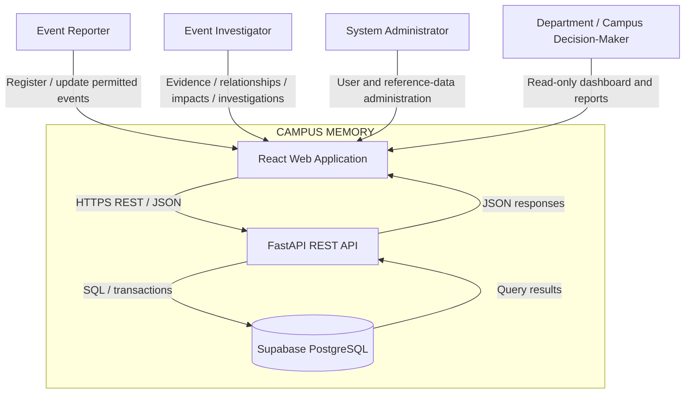

### 4.3 Context boundary

The application does not integrate with campus ERP, timetable, network monitoring, SMS, email, or telemetry systems in version 1. Scheduled activities such as lab sessions are entered as project data; automated synchronization is out of scope (v0.2 Section 5.2). Real campus information may be used only with authorization; otherwise the dataset must be visibly synthetic (v0.2 Section 15).

---

## 5. Container and Component Architecture

### 5.1 Logical container diagram

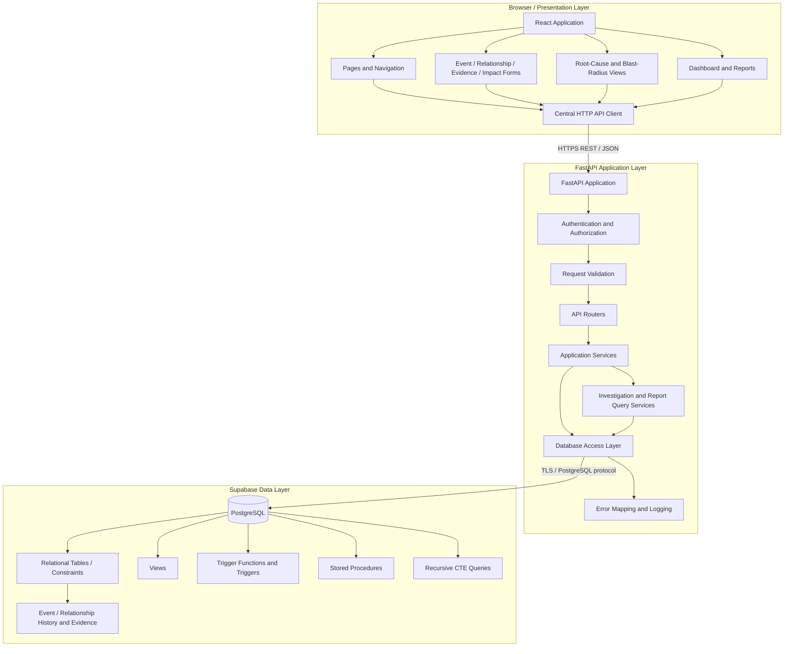

### 5.2 Frontend responsibilities

The React application is responsible for:

- Displaying the four user-role experiences and navigation.
- Collecting user input through forms and validating basic field formats.
- Calling FastAPI endpoints through one central API client.
- Displaying server-side validation and authorization errors.
- Rendering event lists, event details, history timelines, investigation results and reports.
- Showing confirmed, suspected and rejected relationship states distinctly.
- Presenting estimated and verified impacts separately.

The frontend is not the authority for permissions or database integrity. Hiding a button is a user-experience measure only; FastAPI must still check authorization on every request.

### 5.3 Backend responsibilities

FastAPI is responsible for:

- Verifying the caller's authentication token.
- Resolving the trusted application user identifier and role.
- Enforcing role-based authorization.
- Validating request payloads and query parameters.
- Coordinating application use cases and database transactions.
- Executing parameterized SQL, views and `CALL` statements for the stored procedures.
- Mapping database constraint/trigger/procedure failures to safe API errors (NFR-020).
- Returning a stable JSON response contract.
- Logging request identifiers and non-sensitive operational details.

It must not simulate the required database triggers, views or procedures with Python functions.

### 5.4 Database responsibilities

PostgreSQL is the authority for:

- Relational persistence and referential integrity.
- Keys, constraints and indexes.
- Database views.
- Trigger functions and trigger definitions.
- Stored procedures.
- Recursive root-cause and blast-radius query execution.
- Event status history and evidence-validation rules proposed in v0.2.

The actual entities, attributes, types, constraints and table names beyond the planning convention `campus_event` are deferred to the Database Schema Document.

---

## 6. Frontend Architecture — React

### 6.1 Proposed frontend organization

**[A]** A small feature-oriented structure is recommended. The team may use JavaScript or TypeScript; TypeScript is recommended for the API contracts and shared models, but that is a team decision and not a faculty requirement.

```text
frontend/
├── public/
├── src/
│   ├── app/
│   │   ├── App.tsx
│   │   ├── routes.tsx
│   │   └── providers/
│   ├── components/
│   │   ├── layout/
│   │   ├── forms/
│   │   ├── tables/
│   │   ├── status-badges/
│   │   └── feedback/
│   ├── features/
│   │   ├── auth/
│   │   ├── events/
│   │   ├── relationships/
│   │   ├── evidence/
│   │   ├── impacts/
│   │   ├── investigations/
│   │   ├── dashboard/
│   │   └── reports/
│   ├── lib/
│   │   ├── api-client.ts
│   │   ├── auth-client.ts
│   │   └── error-mapping.ts
│   ├── types/
│   ├── styles/
│   └── main.tsx
├── .env.example
├── package.json
└── README.md
```

This is a proposed organization, not a claim that these files already exist. Keep environment variables that are shipped to the browser limited to non-secret configuration such as the FastAPI base URL and, if Supabase Auth is selected, the Supabase project URL and publishable key.

### 6.2 Main pages and components

| Page / module | Main responsibility | Main API areas |
|---|---|---|
| Login / session | Sign in, sign out, display session state | Auth service or Supabase Auth, depending on D-05 |
| Dashboard | Open events by category, severity, recent events, recurring assets/locations | Dashboard and recurrence |
| Event list | Search, filter and paginate Campus Events | Events |
| Event detail | Display core details, related events, impacts, evidence summary and status history | Event detail, relationship, impact and history |
| Event registration | Create a Campus Event | Event creation |
| Event update | Update permitted fields and status | Event update/status/close/void |
| Relationship workspace | Create directional relationships and manage confidence/status | Relationships |
| Evidence panel | Attach and review evidence | Evidence |
| Impact workspace | Record affected object, impact type, quantity, unit and verified/estimated status | Impacts |
| Root-cause explorer | Display upstream event chain, depth, link status and confidence | Root-cause investigation |
| Blast-radius explorer | Display downstream events and deduplicated impacts | Blast-radius investigation |
| Timeline | Display event times and available historical status records | Temporal/history |
| Reports | Generate Event Summary and Event Investigation reports | Reports |
| Admin / reference data | Manage users, roles and controlled reference data | Admin/reference data |

### 6.3 Proposed forms PF-1 to PF-5

The five forms below are the project forms proposed in v0.2. They are **not** confirmed as the official faculty form categories; that mapping remains pending under A-17 and D-20.

| Form | Frontend responsibility | Important behavior |
|---|---|---|
| PF-1 — Event registration | Collect the Campus Event's required fields and submit creation | Show required-field errors; the backend/database assigns identity and initial status history |
| PF-2 — Event update | Edit event details and request status/close/void operations | Show only actions allowed for the user's role; backend rechecks permissions; status history is database-generated |
| PF-3 — Relationship and evidence | Select cause/effect events, create a suspected relationship, add evidence, confirm or downgrade | Show evidence requirement and require a reason for downgrade; database remains authoritative |
| PF-4 — Impact entry | Record impact type, affected object, quantity, unit, and verified/estimated flag | Do not combine unlike units in a single total |
| PF-5 — Investigation/search | Filter events and request root-cause or blast-radius results | Offer confirmed-only or include-suspected traversal; visibly label suspected links |

### 6.4 Component and state design

- Use small reusable components for event status, severity, relationship status, evidence lists, validation messages, empty states, loading states and error summaries.
- Keep server-owned data in request/response objects; do not treat client state as persisted truth.
- Keep only the minimum UI state required for interaction, such as search filters, selected event, investigation mode, current form values and session state.
- Derive filtered or summarized display values from fetched data where practical rather than maintaining duplicate state.
- Use a central API client so headers, base URL, timeouts, token attachment and error parsing are consistent.
- Avoid adding global state-management packages until component state and React context prove insufficient.

### 6.5 Validation and feedback

The browser can provide immediate user-friendly checks (required fields, basic formats, numeric ranges, date ordering), but FastAPI must validate the request again. PostgreSQL must enforce durable relational rules. Display:

- Field-level validation messages.
- Loading states for slow operations.
- Empty-state messages when no records match.
- Clear authorization errors.
- Clear conflict messages when a database rule rejects an operation.
- A correlation/request ID for unexpected errors when available.

Do not display raw database exception text, connection strings or stack traces.

### 6.6 JavaScript versus TypeScript

JavaScript is sufficient to build a React UI. TypeScript adds static checking for API request/response shapes and event/status types, which is helpful when four people work on separate frontend and backend tasks. **Recommendation [A]: use TypeScript if all team members can work with it; otherwise use JavaScript with documented JSDoc types and consistent API examples.** The choice is not an architectural dependency and must be recorded by the team before implementation.

---

## 7. Backend Architecture — Python and FastAPI

### 7.1 Request-processing flow

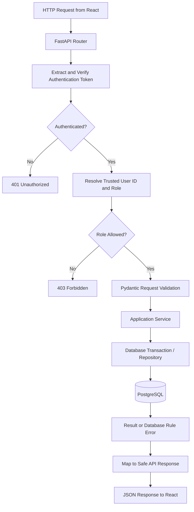

### 7.2 Proposed backend folder structure

```text
backend/
├── app/
│   ├── main.py
│   ├── core/
│   │   ├── config.py
│   │   ├── security.py
│   │   ├── permissions.py
│   │   └── logging.py
│   ├── api/
│   │   ├── deps.py
│   │   └── v1/
│   │       ├── router.py
│   │       └── endpoints/
│   │           ├── auth.py
│   │           ├── events.py
│   │           ├── relationships.py
│   │           ├── evidence.py
│   │           ├── impacts.py
│   │           ├── investigations.py
│   │           ├── dashboard.py
│   │           └── reports.py
│   ├── schemas/
│   │   ├── event.py
│   │   ├── relationship.py
│   │   ├── evidence.py
│   │   ├── impact.py
│   │   ├── investigation.py
│   │   └── report.py
│   ├── services/
│   │   ├── event_service.py
│   │   ├── relationship_service.py
│   │   ├── evidence_service.py
│   │   ├── impact_service.py
│   │   ├── investigation_service.py
│   │   └── report_service.py
│   ├── repositories/
│   │   ├── event_repository.py
│   │   ├── relationship_repository.py
│   │   ├── impact_repository.py
│   │   └── report_repository.py
│   ├── db/
│   │   ├── connection.py
│   │   ├── transactions.py
│   │   └── procedures.py
│   └── errors/
│       ├── handlers.py
│       └── exceptions.py
├── tests/
│   ├── api/
│   ├── services/
│   └── integration/
├── .env.example
├── .gitignore
├── pyproject.toml or requirements.txt
└── README.md
```

The exact structure may be simplified for a mini-project. Do not create empty modules solely to match this diagram; create them as the implementation grows.

### 7.3 Routers, schemas, services and repositories

| Layer | Responsibility | Example |
|---|---|---|
| Router | HTTP method/path, dependencies, status code, response model | `POST /api/v1/events` |
| Pydantic schema | Validate request and shape response | `EventCreate`, `EventRead` |
| Service | Coordinate use case and authorization-specific business rules | Register event; confirm relationship after evidence is attached |
| Repository / DB access | Run parameterized SQL and call database procedures | `INSERT`, `SELECT`, `CALL register_event(...)` |
| Database | Final integrity checks and durable side effects | PK/FK, TG-1, TG-2, views and procedures |

FastAPI `APIRouter` modules and shared dependencies are appropriate for keeping endpoint groups separate. The FastAPI documentation describes including routers and applying shared dependencies at router level [R4, R5].

### 7.4 Request and response validation

Use Pydantic request models to define accepted input. Examples of conceptual request models (not implementation code) include:

- `CampusEventCreate`: title, description, category, type, severity, location/asset reference, start time, optional end time and scheduled activity reference.
- `RelationshipCreate`: cause event ID, effect event ID, confidence and explanation; new relationship defaults to suspected.
- `EvidenceCreate`: evidence type, description, source/reference.
- `ImpactCreate`: impact type, affected object reference, quantity, unit, verified/estimated flag.
- `InvestigationRequest`: root event ID, link inclusion mode and optional as-of time.

Do not accept `created_by`, `last_modified_by`, `recorded_by`, or actor identity as trusted free-form values from the browser. Derive the actor from the verified authentication context on the backend.

### 7.5 Transactions and procedure invocation

Operations that comprise one logical use case must be atomic. For example, SP-1 should register an event and rely on TG-1 to insert the initial status history. If a statement fails, the transaction should roll back rather than leave partial data. SP-2 changes the status and reason; TG-1 writes the corresponding history record. The API calls stored procedures with PostgreSQL `CALL` and does not write status history itself.

Use one transaction-scoped connection for all operations in a logical unit. If actor identity is passed to PostgreSQL using a transaction-local setting, set it and perform the write inside the **same transaction**. Do not set session-wide identity values on a pooled connection and leave them behind for the next request.

### 7.6 Error handling

The backend should map known database errors into stable API errors, for example:

| Condition | HTTP response proposal | Client message |
|---|---:|---|
| Missing/invalid token | 401 | Sign in is required or session is invalid |
| Authenticated but role not permitted | 403 | You do not have permission for this action |
| Record not found | 404 | The requested event/relationship was not found |
| Input validation failure | 422 | One or more fields are invalid |
| Duplicate ordered relationship / self-link | 409 or 422 | This relationship cannot be created |
| Confirmed relationship has no evidence | 409 or 422 | Attach evidence before confirming |
| Last evidence cannot be removed | 409 or 422 | Downgrade the relationship before removing its last evidence |
| Unexpected database/system failure | 500 | The operation could not be completed; provide the request ID |

Exact status codes may be finalized in the API contract. Never expose SQL text, internal table details, credentials, raw stack traces or sensitive exception context to clients.

### 7.7 Logging

Log request ID, route, response status, duration, actor identifier where permitted, and a sanitized error code. Do not log passwords, bearer tokens, refresh tokens, database URLs, service-role keys, or private evidence content by default. Log enough to debug failures without copying secrets into GitHub or demo screenshots.

---

## 8. Database Connectivity Architecture

### 8.1 Proposed driver

**[A] Proposed driver: Psycopg 3 (`psycopg`).** It is a PostgreSQL adapter for Python and supports connection objects, transactions, parameterized commands, and asynchronous connections. The official Psycopg documentation describes both synchronous and asynchronous connection options and transaction behavior [R8].

For the initial student project, prefer a simple connection/pool design that the team can understand and test. Do not add an ORM solely for convenience: the course requires visible SQL work, and recursive queries, views, trigger functions and procedures must remain directly demonstrable in SQL.

### 8.2 Connection options

Supabase documents different connection choices according to where the application runs and the IP/network support of the client [R1, R2].

| Option | Typical use | Advantages | Constraints / considerations | CAMPUS MEMORY assessment |
|---|---|---|---|---|
| Direct PostgreSQL connection | Persistent backend with IPv6 access, or IPv4 add-on | Direct connection; suitable for long-running servers and native database tools | Direct endpoint may be IPv6-only unless project has IPv4 add-on; each connection uses a database connection | Good for a persistent backend **if** the deployment network can reach it |
| Shared pooler — session mode | Persistent backend on IPv4-only network | IPv4 connectivity; session features and prepared statements supported | Adds a pooler hop; user/host string differs from direct connection | Strong alternative if one or more team/deployment networks are IPv4-only |
| Shared pooler — transaction mode | Serverless/edge workloads with many short-lived connections | Designed for short-lived connection bursts | Prepared statements are not supported by the shared transaction pooler; session state and other features do not persist across transactions | Not the default for a normal persistent FastAPI service; use only if the runtime needs it and driver settings are compatible |
| Dedicated pooler | Higher-load deployment on eligible Supabase plans | Pooler close to database; lower network hop than shared pooler | Plan availability and connection mode constraints; not assumed affordable or available | Not required for the mini-project unless measured need and plan support exist |

### 8.3 Recommendation and unresolved connection decision (D-07)

**Recommendation [A]:** run FastAPI as a persistent backend. Test direct connectivity from the actual deployment host and each team member's development machine. If the persistent backend can reach the direct endpoint over IPv6 (or the project has IPv4 connectivity), use direct connection. If the backend network is IPv4-only and the direct endpoint is unreachable, use Supabase's shared **session-mode** pooler. Keep transaction mode for short-lived/serverless execution rather than selecting it by default.

The exact choice remains **D-07 — Pending team confirmation**, because the deployment environment and network characteristics are not specified in v0.2. Supabase's connection guide provides the current decision table and describes the prepared-statement/session-state limitations of transaction mode [R1].

### 8.4 Connection pool and transaction rules

- Create the application pool once at application startup/lifespan, not on every HTTP request.
- Configure a conservative pool size suitable for a small student application and the selected Supabase plan; measure before increasing it.
- Acquire a connection for each request/use case and return it reliably.
- Use a transaction for multi-step changes (register event, close event, relationship/evidence changes).
- Set a connection timeout and handle unavailable database errors cleanly.
- Avoid holding a database connection while waiting for user input or doing unrelated slow work.
- Do not keep a transaction open across multiple HTTP requests.
- Confirm pool size against Supabase connection limits before deployment [R2].

### 8.5 SSL/TLS

Use an encrypted PostgreSQL connection. Supabase recommends SSL for database connections and documents certificate verification options. `sslmode=require` encrypts but does not by itself verify server identity; stronger verification uses the project's root certificate with verification configured in the driver [R1]. The implementation should prefer certificate verification where the environment and driver configuration permit it. Do not place certificate private material or passwords in the repository.

### 8.6 Parameterized SQL

All user-controlled values must be passed as SQL parameters using the driver, not concatenated into SQL text. Dynamic identifiers (such as a sort-column name) cannot generally be passed as ordinary value parameters; allow-list such identifiers in backend code. Parameterization reduces SQL injection risk but does not replace authorization or least-privilege database permissions.

### 8.7 Database role

**[A] Recommendation:** create a dedicated application database role with only the required schema/table/function privileges. Do not use the Supabase project owner/postgres administrative account for routine web requests. Restrict DDL/migration authority to maintainers; the runtime account should not be able to alter tables or create arbitrary objects. Final grants and RLS policy choices belong in the Database Schema/Security design.

---

## 9. Authentication and Authorization Architecture

### 9.1 Authentication options (D-05)

| Option | Advantages | Disadvantages / work | Status |
|---|---|---|---|
| Supabase Auth | Hosted user lifecycle and sign-in support; can issue signed access tokens; avoids building password storage and reset flows from scratch | Must configure project Auth; backend must validate tokens correctly; roles/permissions still need project design; Auth endpoints are a separate service | Recommended for evaluation; **pending team decision** |
| Application-managed authentication | Full control over users, password hashing, sessions and role model; keeps identity model inside the project backend | Team must correctly implement password hashing, login, token issuance, expiration, refresh/revocation and password-reset handling; more security-sensitive code | Possible but more work; not preferred for this small team unless faculty/project constraints require it |

**Recommendation [A]:** prefer Supabase Auth for identity management if its use is approved by the team. React can use the Supabase Auth client for sign-in/session operations with the project URL and publishable key. It then sends the access token to FastAPI in `Authorization: Bearer <token>`. FastAPI validates the token and performs all application-data authorization before accessing PostgreSQL. This does not use the Supabase Data API for application records. If the team chooses application-managed authentication, document and test password hashing and token lifecycle explicitly rather than inventing a lightweight custom scheme.

### 9.2 Authentication flow

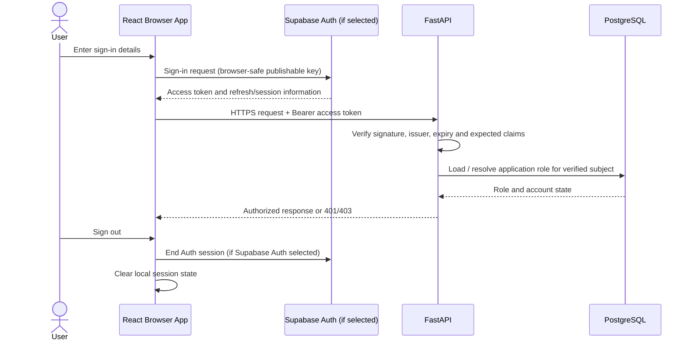

If application-managed authentication is selected, replace the Supabase Auth exchange with the backend's login/token endpoints and use a proven password-hashing library and signed-token validation. The API must not trust user identity or role values included as ordinary request-body fields.

### 9.3 Token validation

FastAPI must validate, not merely decode, the bearer token. Validation must include:

- Cryptographic signature using the correct project signing-key configuration.
- Issuer (`iss`) matching the expected Supabase Auth issuer.
- Expiration (`exp`) and not-before (`nbf`) when present.
- Expected audience (`aud`) where configured.
- Subject (`sub`) presence and valid user mapping.
- Any application status/role lookup required by the authorization design.

Supabase publishes signing-key/JWKS documentation and explains that asymmetric public keys can be used to verify token signatures [R6]. If the project still uses a legacy symmetric signing secret, do not copy the secret into browser code or casually distribute it to application developers; use the supported server-side verification path selected during implementation. FastAPI's security utilities provide bearer-token extraction and integration with OpenAPI, but token signature validation and authorization still need to be implemented [R4, R5].

### 9.4 Proposed role-permission matrix

The role descriptions below reproduce the proposal in Planning Document v0.2 Section 6. Final policy is D-05 and must be implemented on the backend.

| Capability | Administrator | Event Reporter | Event Investigator | Decision-Maker |
|---|---:|---:|---:|---:|
| View events | All | Permitted scope | Permitted scope | Read-only |
| Register event | Yes | Yes | Yes, if assigned | No |
| Update own open event | Yes | Yes | Yes, subject to role policy | No |
| Update another user's event | Yes, audited | No | Only where required for investigation; confirm policy | No |
| Manage locations/assets/reference data | Yes | No | No | No |
| Manage users and roles | Yes | No | No | No |
| Create event relationships | Yes | No | Yes | No |
| Attach evidence | Yes | No | Yes | No |
| Confirm/downgrade relationships | Yes, under role policy | No | Yes, with evidence/reason rules | No |
| Record impacts | Yes | No | Yes | No |
| Change event status | Yes | Limited by reporter's own open-event rules | Yes | No |
| Close / void event | Yes | No | Yes to close; void per admin policy | No |
| Run root-cause / blast-radius | Yes | Read-only result if allowed | Yes | Read-only |
| View dashboard/reports | Yes | As allowed | Yes | Yes, read-only |

**Permission note:** v0.2 allows the administrator to view everything and perform administrative correction under audit; the reporter can update their own open events; the investigator manages relationships, evidence, impacts and investigations; the decision-maker is read-only. Any extra permission in the table is a proposed interpretation and must be agreed by the team before implementation.

### 9.5 Passing authenticated identity to database triggers (D-22)

TG-1 needs to record the actor who caused a status change. PostgreSQL does not automatically know the verified HTTP user from FastAPI. The backend must supply the identity derived from a validated token, not from a user-supplied form field.

**Proposed approach [A]: transaction-local database context.** After validating the bearer token and resolving its trusted `sub` to an application user, FastAPI opens a transaction and sets a transaction-local context value (for example, a custom PostgreSQL setting such as `app.actor_id`) using a parameterized statement. It then performs the write or calls SP-1/SP-2 in the same transaction. TG-1 reads the context and records the actor. The context must be transaction-local so it does not leak to a later request that reuses the pooled connection.

Alternative: pass a verified actor identifier explicitly to a stored procedure. Either way, only FastAPI may supply the value after token verification and role authorization. The actor must not be accepted as a trusted browser-supplied field.

**Security limitation:** a custom session setting is context propagation, not a cryptographic identity proof. Anyone holding the database credentials may set it. Therefore, the database credential must remain backend-only, the runtime role must be restricted, and the application must validate the token before setting the context. Direct SQL Editor tests are administrative tests and should use clearly identified test actors.

### 9.6 Logout and session handling

If Supabase Auth is selected, React should use the Auth SDK's sign-out/session mechanisms and stop sending the old access token. FastAPI must reject expired or invalid tokens even if the UI still displays a signed-in state. Logout from the browser does not make an unexpired token disappear from an attacker’s possession; keep token lifetimes and refresh behavior to the selected Auth configuration. Do not store tokens in insecure custom locations without a reviewed decision.

---

## 10. API Architecture and Proposed Endpoint Catalogue

### 10.1 API conventions

**[A] Proposed API base path:** `/api/v1`.

- Use plural resource names and standard HTTP verbs.
- Use JSON request and response bodies.
- Use ISO 8601 timestamps with timezone offsets; normalize storage in PostgreSQL using `TIMESTAMPTZ` as decided in the schema.
- Use UUID or other opaque record identifiers according to the final schema; do not bake an identifier type into frontend logic until the Database Schema Document decides it.
- Use pagination and validated filters for event lists.
- Send bearer tokens on protected requests.
- Keep a consistent error response, for example `{ "error": { "code": "...", "message": "...", "request_id": "..." } }`.
- Never use an HTTP endpoint as a substitute for a required database procedure/trigger/view.

### 10.2 Events

| Method and path | Purpose | Authorized role | Request / response outline | Important validation / errors | Related FR |
|---|---|---|---|---|---|
| `POST /api/v1/events` | Register a Campus Event | Administrator, Reporter, Investigator | Request: event fields; response: created event ID and summary | Required fields, controlled category/type/severity, start/end ordering; 401/403/422/500 | FR-001–003, FR-007–008, SP-1 |
| `GET /api/v1/events` | List/search events | Authenticated roles according to scope | Query: category, type, status, severity, location/asset, date range, keyword, page/limit; response: results and pagination | Validate filters/date range/page size; 401/403/422 | FR-035, FR-041–042 |
| `GET /api/v1/events/{event_id}` | Retrieve event detail | Authenticated roles according to scope | Response: event detail and related summaries | 404 if missing; enforce visibility scope | FR-004 |
| `PATCH /api/v1/events/{event_id}` | Update permitted event fields | Administrator; Reporter for own open event; Investigator only under agreed scope | Request: permitted changed fields; response: updated event | Owner/status permission; last-modified metadata; 404/403/422 | FR-005–007 |
| `PATCH /api/v1/events/{event_id}/status` | Change event status | Administrator, Investigator; reporter only if policy permits | Request: target status and reason; response: event status | Validate allowed transition; TG-1 inserts history; 409/422 for invalid transition | FR-033–034 |
| `POST /api/v1/events/{event_id}/close` | Close event through SP-2 | Administrator, Investigator | Request: closing reason; response: closed event summary | Event must exist and be in a closable state; reason required; TG-1 records history | FR-033, SP-2 |
| `POST /api/v1/events/{event_id}/void` | Mark event void (not hard-delete) | Administrator; additional role only if explicitly approved | Request: void reason; response: voided event | Reason required; no hard deletion; 404/403/409 | FR-006 |

### 10.3 Relationships and evidence

| Method and path | Purpose | Authorized role | Request / response outline | Important validation / errors | Related FR |
|---|---|---|---|---|---|
| `POST /api/v1/relationships` | Create directed cause→effect relationship | Investigator, Administrator | Request: cause ID, effect ID, confidence, explanation; response: relationship summary | No self-link, no duplicate ordered pair; default suspected; 409/422 | FR-009–013 |
| `GET /api/v1/events/{event_id}/relationships` | List an event's incoming/outgoing links | Authenticated roles by scope | Query: direction and status; response: relationship details | Event must exist; role/visibility check | FR-004, FR-018–023 |
| `POST /api/v1/relationships/{relationship_id}/evidence` | Attach evidence | Investigator, Administrator | Request: evidence type, description, source/reference; response: evidence summary | Relationship exists; validate evidence metadata; 404/403/422 | FR-015 |
| `POST /api/v1/relationships/{relationship_id}/confirm` | Confirm relationship | Investigator, Administrator | Request: optional confirmation note; response: confirmed relationship | Database must verify at least one evidence row; 409/422 if none | FR-012 |
| `POST /api/v1/relationships/{relationship_id}/downgrade` | Downgrade confirmed relationship | Investigator, Administrator | Request: target suspected/rejected status and reason; response: updated relationship | Non-empty reason; retain evidence; 409/422 | FR-047 |
| `GET /api/v1/relationships/{relationship_id}/history` | Retrieve relationship history | Investigator, Administrator; read-only roles by policy | Response: status/confidence history | 404/403; history read-only | FR-016 |

Evidence deletion/reassignment should not be exposed as a normal user action in v1 unless a specific authorized workflow is designed. Any deletion must still pass database enforcement (FR-048); the API cannot bypass TG-2.

### 10.4 Impacts

| Method and path | Purpose | Authorized role | Request / response outline | Important validation / errors | Related FR |
|---|---|---|---|---|---|
| `POST /api/v1/events/{event_id}/impacts` | Record event impact | Investigator, Administrator | Request: impact type, affected object, quantity, unit, verified/estimated; response: impact summary | Event exists; quantity/unit validated; actor derived from token | FR-024 |
| `GET /api/v1/events/{event_id}/impacts` | Retrieve event impacts | Authenticated roles by scope | Response: impact rows and verification labels | 404/403 | FR-004, FR-024 |
| `PATCH /api/v1/impacts/{impact_id}` | Correct impact record | Investigator, Administrator | Request: permitted impact fields and correction reason where required; response: updated impact | Validate units, affected object, verified/estimated status; impact-history policy to be finalized | FR-024, FR-025, FR-028 |

### 10.5 Investigation and temporal queries

| Method and path | Purpose | Authorized role | Request / response outline | Important validation / errors | Related FR |
|---|---|---|---|---|---|
| `GET /api/v1/events/{event_id}/root-causes` | Traverse upstream causes | Investigator, Administrator; read-only roles by policy | Query: `link_mode=confirmed_only` or `include_suspected`; response: unique events, minimum depth, link status/confidence | Event exists; cycle-safe query; unsupported mode → 422 | FR-018–022 |
| `GET /api/v1/events/{event_id}/blast-radius` | Traverse downstream effects and impacts | Investigator, Administrator; read-only roles by policy | Query: link mode; response: unique downstream events, minimum depth, impacts grouped by type and verified/estimated status | Cycle-safe query; deduplication rule; do not sum unlike units | FR-023–028, FR-049 |
| `GET /api/v1/events/as-of` | Retrieve event status recorded at a selected time | Investigator, Administrator; read-only roles by policy | Query: `at=<timestamp>` and optional filters; response: status based on available status history | Timestamp required and timezone-aware; clarify limitation to historical fields actually stored | FR-029–032 |
| `GET /api/v1/events/{event_id}/status-history` | Read event status timeline | Authenticated roles by scope | Response: initial status and subsequent status changes | Read-only; 404/403 | FR-033–034 |

### 10.6 Dashboard, recurrence and reports

| Method and path | Purpose | Authorized role | Request / response outline | Important validation / errors | Related FR |
|---|---|---|---|---|---|
| `GET /api/v1/dashboard/summary` | Summary cards and recent events | Administrator, Investigator, Decision-Maker; Reporter scope by policy | Response: open events by category, severity, recent events | Date/filter validation; access scope applied | FR-037 |
| `GET /api/v1/analytics/recurrence` | Rank recurring assets/locations | Administrator, Investigator, Decision-Maker | Query: date range and optional category/location; response: counts and impact totals | Date range and unit handling; disclose estimated values | FR-036–037 |
| `GET /api/v1/reports/event-summary` | Generate event summary report | Administrator, Investigator, Decision-Maker | Query: start/end date; response: grouped events by category/status and totals | Validate date range; counts must reconcile with SQL | FR-038 |
| `GET /api/v1/reports/event-investigation/{event_id}` | Generate investigation report | Administrator, Investigator, Decision-Maker | Response: event, root-cause chain, blast radius, impacts and evidence | Event exists; same traversal/deduplication rules as investigation endpoints | FR-039 |

**Academic note:** the interpretation of “two generated reports” and whether a separate Phase 2 report document is required remain unverified (CU-11, D-20). The endpoints above are the two application reports proposed by v0.2, not a claim about the official rubric.

### 10.7 API authorization design

Authorization should be expressed as reusable FastAPI dependencies/policies, not repeated ad hoc checks in each endpoint. Each route declares the minimum role/capability. For owner-sensitive operations, the service checks both the role and record ownership/open status. The backend derives identity from the verified token and never relies on client-side role values.

---

## 11. Data Flow and Sequence Diagrams

### 11.1 Registering a Campus Event

```mermaid
sequenceDiagram
    actor Reporter
    participant R as React
    participant F as FastAPI
    participant DB as PostgreSQL
    Reporter->>R: Complete event form
    R->>F: POST /api/v1/events + bearer token
    F->>F: Verify token and reporter permission
    F->>F: Validate request fields
    F->>DB: Begin transaction; set trusted actor context
    F->>DB: CALL register_event(...)
    DB->>DB: Insert Campus Event
    DB->>DB: TG-1 records initial status history
    DB-->>F: New event identifier and result
    F->>DB: Commit transaction
    F-->>R: 201 Created + event summary
    R-->>Reporter: Show event detail
```

### 11.2 Changing status and TG-1 history

```mermaid
sequenceDiagram
    actor Investigator
    participant R as React
    participant F as FastAPI
    participant DB as PostgreSQL
    Investigator->>R: Select new status and enter reason
    R->>F: PATCH /api/v1/events/{id}/status + token
    F->>F: Verify token, role and transition
    F->>DB: Begin transaction; set actor context
    F->>DB: Update event status
    DB->>DB: TG-1 checks OLD.status <> NEW.status
    DB->>DB: Insert status-history row
    DB-->>F: Updated event
    F->>DB: Commit
    F-->>R: 200 OK + current status
    R-->>Investigator: Display updated timeline
```

If a non-status field changes, or a status is set to its current value, TG-1 must not create an additional status-history row (FR-033).

### 11.3 Creating relationship, attaching evidence and confirming

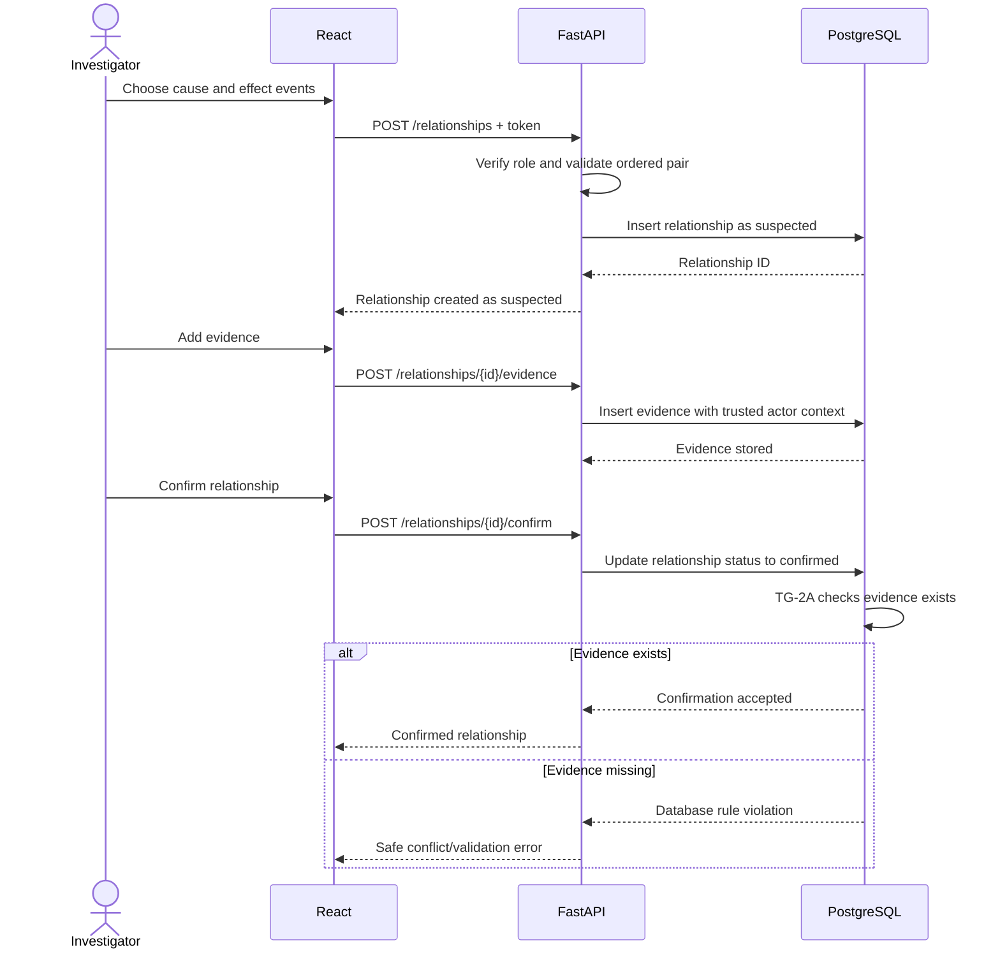

### 11.4 Root-cause analysis

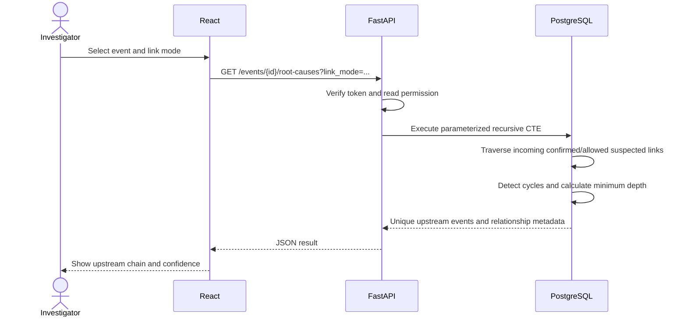

### 11.5 Blast-radius analysis

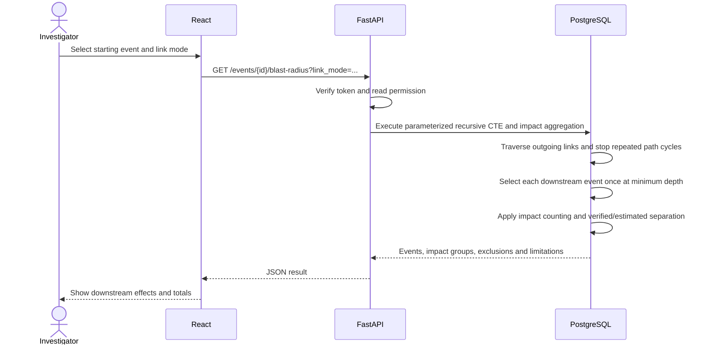

### 11.6 Report generation

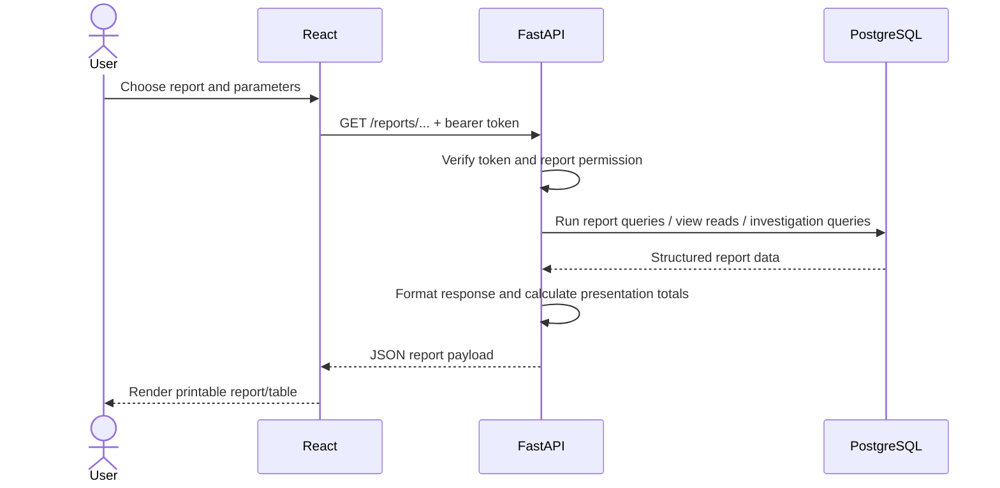

### 11.7 Login flow

See Section 9.2. It shows the proposed Supabase Auth option; if application-managed authentication is chosen, the identity provider and token issuance step change but the FastAPI authorization boundary remains.

---

## 12. Security Architecture

### 12.1 Authentication versus authorization

- **Authentication** answers who the caller is. The selected implementation must verify a signed token or use another server-side identity verification mechanism.
- **Authorization** answers what that caller can do. FastAPI resolves the application's role and checks the requested operation and, where required, record ownership/status.

A signed-in user is not automatically authorized to edit every event. A frontend route guard is not a replacement for a backend authorization check.

### 12.2 Secrets and keys

| Item | Allowed location | Rule |
|---|---|---|
| PostgreSQL connection string/password | Backend secret environment only | Never in React, browser storage, screenshots, or Git |
| Supabase secret/service-role key | Backend only, if genuinely required | Never expose to the browser; these keys bypass RLS according to Supabase documentation [R3] |
| Supabase publishable key | Browser may use it for Auth client initialization if Supabase Auth is selected | It is not a database password; keep RLS/grants and endpoint access rules correct [R3] |
| FastAPI API base URL | React build configuration | Not a secret |
| User access token | Session handling and Authorization header | Do not log it or expose it in error reports |
| `.env` files | Local backend runtime; ignored by Git | Commit only `.env.example` with placeholders |

### 12.3 Database access and Supabase Data API

The project's selected data path uses direct PostgreSQL connectivity from FastAPI. Supabase also provides Data APIs. Because the architecture intends application data to pass through FastAPI, the team should either disable the Data API if not needed, or restrict it and test that it cannot provide a bypass to application tables. Supabase documents that direct database connections can be used from trusted servers and that the Data API can be disabled when only direct connections are used [R3].

Do not disable Supabase Auth endpoints if Supabase Auth is the chosen identity provider. Disabling the database Data API and using the Auth service are separate considerations.

### 12.4 Database privileges and RLS

- Use a dedicated least-privilege application database role.
- Keep migration/DDL permissions separate from runtime permissions.
- Do not assume RLS protects a request if the backend connects as a database owner or role with RLS bypass privileges.
- Decide whether RLS will be used as defense-in-depth for the runtime database role; test the actual role, grants, table ownership and policies.
- Restrict direct SQL Editor access to project maintainers and treat it as an administrative path.
- Do not expose database credentials to team members who do not need them; rotate credentials if leaked.

### 12.5 CORS and transport security

- Configure FastAPI CORS with the exact React development and deployment origins used by the team; do not use wildcard origins with credentials.
- Use HTTPS for browser-to-API traffic in any hosted environment.
- Use SSL/TLS for FastAPI-to-PostgreSQL connections and verify certificates where supported.
- Avoid sending authentication tokens in URL query parameters.

### 12.6 Input and query security

- Validate all request bodies and query parameters using Pydantic and explicit business rules.
- Use parameterized SQL.
- Allow-list dynamic sort fields and other identifiers.
- Enforce critical integrity rules in PostgreSQL, not only in the frontend or backend.
- Do not expose raw database errors to the browser.

### 12.7 Supabase Auth and FastAPI boundary

If Supabase Auth is selected, React uses only the publishable key for authentication flows. The backend validates the user token and authorizes every data request. The application does not send the service-role key to the browser. The application-data API remains FastAPI, even if the Auth service is contacted directly for sign-in and session refresh.

### 12.8 Evidence and audit security

- Evidence source/reference fields may contain sensitive information; apply access checks before returning them.
- Do not allow ordinary clients to edit/delete event status history.
- Require reason text for relationship downgrades and event closure/void operations according to v0.2.
- Log actor identifiers and operation outcome without logging secret tokens or unnecessarily copying evidence content.
- Preserve the distinction that v1 provides status history and last-modified metadata; full field-level audit is not included unless D-15 changes scope.

---

## 13. Deployment Architecture

### 13.1 Development environment

**[A] Proposed development setup:** each team member runs React and FastAPI locally, while the team uses one designated Supabase development project or a local Supabase/PostgreSQL environment. The exact use of local containers and the hosting of the frontend/backend remain pending (D-07, D-09).

### 13.2 Deployment diagram

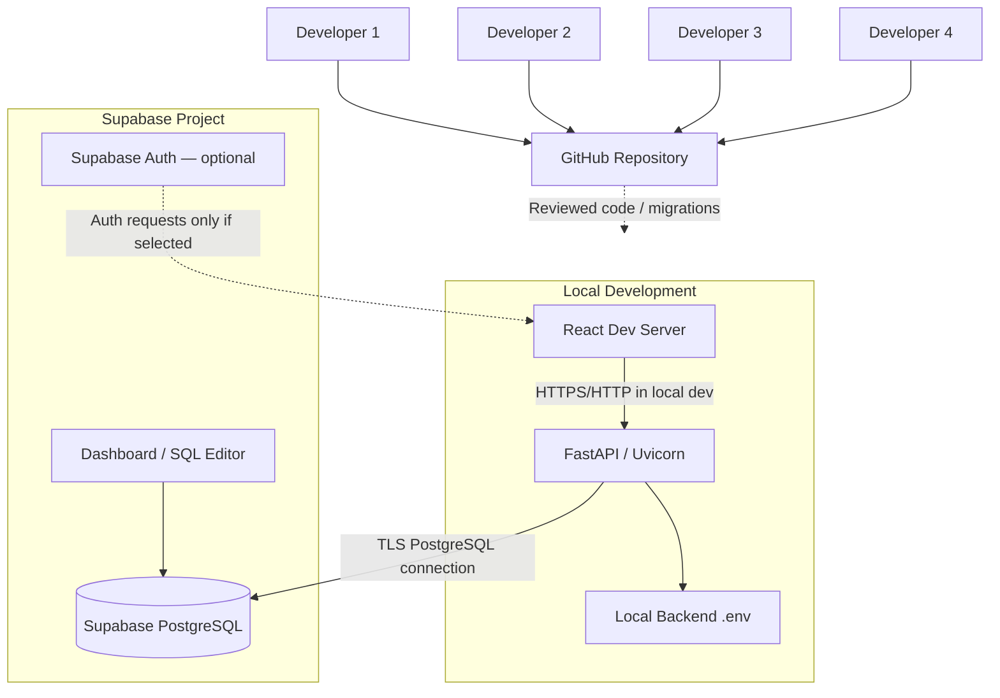

The diagram separates the optional Supabase Auth path from application-data access. The normal web data path is React → FastAPI → PostgreSQL.

### 13.3 Local development

1. Clone the GitHub repository.
2. Install the supported Node.js environment and Python version selected by the team.
3. Install frontend and backend dependencies using lockfiles/pinned dependency metadata.
4. Copy `.env.example` to a local backend `.env` and fill secrets from the Supabase Dashboard using a secure channel.
5. Start React and FastAPI locally.
6. Verify `/health` (or the agreed health endpoint) without exposing secret configuration.
7. Test FastAPI-to-PostgreSQL connectivity.
8. Run the approved migration workflow and synthetic seed data against a development database.

Never commit real `.env` files or paste connection strings into shared issue trackers.

### 13.4 Hosted deployment

For the academic demonstration, local React/FastAPI with a hosted Supabase database may be sufficient, subject to faculty/demo requirements. If the frontend or API is later hosted, choose hosting only after checking budget, platform limits, IPv4/IPv6 reachability, environment-variable support, logs and TLS. No paid hosting plan is assumed.

### 13.5 Environment separation

At minimum distinguish:

- **Development:** schema changes and synthetic data; safe for experimentation.
- **Demonstration:** stable dataset and versioned migrations; avoid destructive changes during rehearsal.

If only one Supabase project is available, mark it as a development/demo project and take a schema/data export before major changes. Do not use real campus personal data without permission.

---

## 14. Database Migration and Team Collaboration Architecture

### 14.1 Repository organization

**[A] Proposed top-level structure:**

```text
CAMPUS_MEMORY/
├── frontend/
├── backend/
├── supabase/
│   ├── config.toml
│   ├── migrations/
│   └── seed.sql
├── database/
│   ├── queries/
│   ├── relational_algebra/
│   └── tests/
├── docs/
│   ├── CAMPUS_MEMORY_Planning_Document_v0.2.md
│   ├── CAMPUS_MEMORY_Architecture_Design_v1.0.md
│   ├── CAMPUS_MEMORY_Database_Schema_v1.0.md
│   └── test-evidence/
├── .gitignore
└── README.md
```

### 14.2 Migration principles

- SQL migration files in Git are the source of truth for schema changes.
- Use ordered/timestamped migrations that can be reviewed before application.
- Test migrations against a local/dev database before remote application.
- Keep seed data separate from schema migrations unless the team's migration conventions intentionally include a small reference-data migration.
- Do not edit the remote schema manually after a migration workflow is established; capture every schema change in a migration first.
- One designated team member coordinates remote migration deployment to avoid concurrent pushes.
- Keep destructive migrations separate, reviewed and backed up.

Supabase's migration guidance describes generating migration files, resetting/testing locally, linking a remote project and pushing migrations. It also warns that direct remote schema edits can desynchronize migration history [R7]. The final CLI steps depend on whether the team can use Docker/Supabase CLI and on the state of the current project.

### 14.3 Proposed team workflow

1. A developer creates a feature branch.
2. For database work, the author adds a new migration file and corresponding tests.
3. The author applies it locally and tests from a clean database reset when feasible.
4. The author opens a pull request with purpose, affected objects, test evidence and rollback considerations.
5. Another team member reviews the SQL/API/UI change.
6. After merge, every developer pulls the migration and rebuilds/updates the local database.
7. R2 or the designated database maintainer coordinates remote deployment after review and explicit project confirmation.
8. Before a demo, export schema/data and verify the tested migration version.

### 14.4 Roles in the architecture workflow

| Role | Primary responsibility | Architecture contribution |
|---|---|---|
| R1 — Project lead and integration | Faculty coordination, repository, diagrams, report, integration and demo | Approves cross-layer changes; maintains architecture decisions and requirement traceability |
| R2 — Database design and SQL | Schema, constraints, seed data, queries, views, triggers, procedures and relational algebra | Owns database interface and reviews all database migrations |
| R3 — Backend | FastAPI, authentication, authorization, DB connectivity, endpoints and tests | Owns API contracts and service/database integration |
| R4 — Frontend | React UI, forms, visualizations, reports and usability | Owns page/component structure and API client integration |

Testing and documentation are shared responsibilities. Names assigned to R1–R4 remain pending D-13.

---

## 15. Architecture Decision Records (ADR)

All decisions below are proposals unless explicitly marked as a team decision. “Selected stack” records the team's stack choice, not faculty DBMS approval.

### ADR-01 — Selected technology stack

- **Context:** The team selected React, Python/FastAPI, Supabase-hosted PostgreSQL, Git and GitHub.
- **Options:** The selected stack; alternatives would require a team/faculty decision.
- **Advantages:** Clear frontend/API/database separation; SQL remains visible; PostgreSQL supports the proposed relational and recursive workloads.
- **Disadvantages / risk:** PostgreSQL is absent from the available summary of allowed DBMS; faculty approval is pending.
- **Proposed decision:** Retain the selected stack while obtaining faculty confirmation.
- **Status:** **Selected by team; faculty approval pending (D-01).**

### ADR-02 — Browser-to-backend communication

- **Context:** The project needs role checks, custom investigation endpoints and database-centric logic.
- **Options:** Browser-to-Supabase Data API; React-to-FastAPI-to-PostgreSQL.
- **Advantages of selected option:** One application authorization boundary; no database credentials in browser; custom workflows and SQL operations remain server-side.
- **Disadvantages:** The team must implement and maintain the API and backend.
- **Proposed decision:** All application data requests pass through FastAPI; no browser-to-PostgreSQL connection.
- **Status:** **Proposed / aligned with selected architecture.**

### ADR-03 — FastAPI database driver

- **Context:** FastAPI must communicate with PostgreSQL using parameterized SQL and transaction handling.
- **Options:** Psycopg 3; another PostgreSQL driver; an ORM abstraction.
- **Advantages of Psycopg 3:** Direct SQL visibility, transaction support, sync/async APIs and a mature PostgreSQL adapter.
- **Disadvantages:** Team must manage SQL and mapping explicitly; async/sync choices need care.
- **Proposed decision:** Psycopg 3, with the minimum pooling features needed.
- **Status:** **Proposed; verify team capability and versions (D-08).**

### ADR-04 — Direct connection versus pooler

- **Context:** Supabase offers direct, session-pooler and transaction-pooler connections. Team network/deployment constraints are unknown.
- **Options:** Direct; shared session pooler; shared transaction pooler; eligible dedicated pooler.
- **Advantages:** Direct for persistent services with network reachability; session pooler as an IPv4 alternative; transaction pooler for short-lived/serverless execution.
- **Disadvantages:** Direct may not work from IPv4-only environments; transaction mode restricts prepared statements and session state; poolers add configuration.
- **Proposed decision:** Test direct connection first for the persistent FastAPI runtime; use session mode if IPv4-only; use transaction mode only if runtime requirements justify it.
- **Status:** **Pending team confirmation (D-07).**

### ADR-05 — Authentication strategy

- **Context:** The application needs sign-in, identity and session validation.
- **Options:** Supabase Auth; application-managed auth.
- **Advantages of Supabase Auth:** Reduces custom password/session lifecycle code.
- **Disadvantages:** Requires Auth configuration and backend token-validation integration; role authorization remains project work.
- **Proposed decision:** Prefer Supabase Auth if acceptable to team; keep application data access through FastAPI.
- **Status:** **Pending team decision (D-05).**

### ADR-06 — Authorization design

- **Context:** v0.2 defines administrator, reporter, investigator and decision-maker roles.
- **Options:** Frontend-only visibility; FastAPI role checks; database-only authorization; layered controls.
- **Advantages of layered design:** Backend checks are consistent for all clients; database privileges protect the persistence boundary.
- **Disadvantages:** More role-matrix testing and permission maintenance.
- **Proposed decision:** Enforce permissions in FastAPI; use least-privilege database grants and consider RLS as defense-in-depth after the database role model is defined.
- **Status:** **Proposed; role scope pending D-05.**

### ADR-07 — Database access and Supabase Data API exposure

- **Context:** The application data path is intentionally FastAPI-to-PostgreSQL.
- **Options:** Keep Data API open with full RLS; restrict it; disable it if not needed.
- **Advantages of restriction/disablement:** Prevents an alternate application-data path from bypassing FastAPI authorization.
- **Disadvantages:** Supabase browser data clients and Data API features would not be available for application data; Auth remains a separate service.
- **Proposed decision:** Disable Data API if compatible with required Supabase services, or restrict and test it so browser data access cannot bypass FastAPI.
- **Status:** **Pending team confirmation (D-06).**

### ADR-08 — SQL versus ORM

- **Context:** The course's DBMS learning outcomes require SQL queries, views, triggers and procedures; recursive queries are central.
- **Options:** Hand-written parameterized SQL; ORM; hybrid.
- **Advantages of SQL-first:** Queries remain visible and easy to demonstrate in SQL Editor; database objects stay explicit.
- **Disadvantages:** More explicit mapping and careful parameterization required.
- **Proposed decision:** Use hand-written parameterized SQL for core database operations; no ORM initially. Reconsider only if complexity justifies it.
- **Status:** **Proposed.**

### ADR-09 — Database migration workflow

- **Context:** Four members need reproducible schema changes.
- **Options:** Ad hoc SQL Editor changes; version-controlled migrations; declarative schema workflow.
- **Advantages of migrations:** Reviewable history and reproducible builds.
- **Disadvantages:** Requires CLI/local environment setup and migration discipline.
- **Proposed decision:** Use Supabase CLI migration files as source of truth; use manual SQL Editor only for controlled exploration or where CLI is not available, then capture changes into migrations.
- **Status:** **Proposed; confirm local tooling availability.**

### ADR-10 — Deployment approach

- **Context:** A student demonstration is required; hosting and budget are unspecified.
- **Options:** Fully local app and database; local React/FastAPI with hosted Supabase DB; hosted frontend/API/database.
- **Advantages of simplest option:** Lower deployment overhead; no paid service assumed.
- **Disadvantages:** Demo depends on local machine and network; remote database connectivity must work.
- **Proposed decision:** Begin with local React and FastAPI connected to a development Supabase database. Host frontend/backend only if faculty/demo needs and budget justify it.
- **Status:** **Pending team confirmation (D-09).**

---

## 16. Architecture Traceability Matrix

This matrix shows where each major planning requirement belongs. It is not a claim that the requirement has been implemented.

| v0.2 requirement | React responsibility | FastAPI responsibility | PostgreSQL responsibility | Main verification |
|---|---|---|---|---|
| FR-001–008 Event registry | Registration, list and detail forms | Validate, authorize and coordinate CRUD/use cases | Persist event data; keys/constraints; TG-1 initial history | SQL + API + UI event test |
| FR-009–017 Relationships/evidence | Relationship and evidence forms; status labels | Role checks, create/attach/confirm/downgrade workflows | Relationship/evidence storage; constraints; TG-2 validation; relationship history if implemented | Direct SQL and API tests |
| FR-018–022 Root-cause | Select event/mode; render upstream chain | Validate request; invoke query; format result | Recursive CTE; cycle prevention; minimum depth and metadata | Chain, branch, cycle tests |
| FR-023–028, FR-049 Blast radius and impacts | Impact form; render downstream effects and grouped totals | Request validation; format distinct impacts and limits | Recursive CTE; impact reads/aggregation; indexes | Diamond, duplicate and unit tests |
| FR-029–032 Temporal investigation | As-of controls and timeline | Validate timestamp; request historical status | Status history and timestamp queries; only fields with stored history can be reconstructed | Historical as-of test |
| FR-033–034 Status history | Read-only status timeline | Set authenticated actor context; return history | TG-1 writes initial/change history | Insert/change/no-op update tests |
| FR-035 Search/filter | Filter controls and results | Parse filters, validate pagination, scope by role | Indexed search/filter SQL | Filter combination tests |
| FR-036–037 Recurrence/dashboard | Cards, charts and recurrence tables | Assemble dashboard/report response | Aggregate queries/views | Reconcile totals with SQL |
| FR-038–040 Reports/export | Render Event Summary and Event Investigation reports | Authorize and assemble report payload | Views and SQL query results | Compare reports with direct SQL |
| FR-041–044 Authentication, roles and forms | Login/session UI; five proposed forms | Token verification, role/owner checks, validation | Users/role references as defined by schema; least-privilege grants | Role/endpoint matrix |
| FR-045 TG-1/TG-2 | Show understandable error messages | Set trusted actor context and map database errors | Actual trigger functions and trigger definitions | Direct SQL trigger tests |
| FR-046 SP-1/SP-2 | Submit form actions | Call procedures and handle result/error | Actual PostgreSQL procedures | `CALL` demonstrations |
| FR-047–048 Downgrade/evidence deletion | Require downgrade reason; explain evidence restriction | Authorize and map database rules | Enforce reason/evidence protection | Concurrency and delete tests |
| FR-050 General audit (future) | Display only if later implemented | Include audit retrieval if later approved | Future audit table/trigger design | Out of v1 unless D-15 changes |
| NFR-001–002 Integrity | Display validation errors | Validate and map constraint errors | PK/FK/NOT NULL/UNIQUE/CHECK and deletion rules | Constraint tests |
| NFR-003–007 Security | No secrets; calls API | Auth, role check, parameterized SQL | Restricted role, optional RLS, Data API controls | Security and exposure tests |
| NFR-008–009 Reliability | Display structured errors | Error mapping and transactions | Atomic procedures/constraints/triggers | Failure tests |
| NFR-010 Performance | Loading feedback | Time API operations | Appropriate indexes and efficient queries | Measured query/API tests |
| NFR-011–012 Usability | Labels, validation and simple investigation views | Stable responses and messages | Consistent reference values | User trial/manual tests |
| NFR-013–014 Maintainability | Feature-oriented source structure | Modular routers/services | Versioned migrations and seed files | Fresh-clone/rebuild test |
| NFR-015–020 Provenance, audit, data labelling, backups, compatibility, database error mapping | Show labels and relationship metadata | Attribute actor and map errors | Store provenance/history and protect integrity | Provenance, backup and direct-SQL tests |

---

## 17. Risks and Technical Limitations

| Risk / limitation | Impact | Proposed mitigation | Related v0.2 decision/risk |
|---|---|---|---|
| PostgreSQL/Supabase may not be permitted by faculty | Possible DBMS migration and SQL rewrite | Obtain written faculty confirmation before deep implementation; keep SQL versioned | D-01, R-01 |
| Authentication choice unresolved | Login/API implementation can diverge | Decide Supabase Auth versus application-managed before M6 | D-05 |
| Direct connection may not work on every network | Local/deployed backend cannot reach DB | Test on all relevant networks; use session pooler where appropriate | D-07, R-09 |
| Database credentials leaked | Unauthorized database access | Backend-only secrets, `.gitignore`, secret scanning, rotation after exposure | NFR-003, R-12 |
| Alternate Supabase Data API path bypasses API authorization | Inconsistent authorization | Disable/restrict Data API and test actual endpoints/grants/RLS | D-06, NFR-007, R-11 |
| Trigger actor identity missing or incorrect | Status history has wrong actor | Validate token in FastAPI; transaction-local trusted context; test pooled-connection cleanup | D-22 |
| Evidence validation race condition | Two concurrent operations may violate “at least one evidence” invariant | Design locking/transaction isolation in schema implementation; concurrency tests | D-18 |
| TG-2 may require multiple actual trigger definitions | Academic trigger counting ambiguity | Document TG-2A and TG-2B definitions explicitly; ask faculty how triggers are counted | D-22, R-19 |
| As-of history is incomplete for non-status fields | Cannot reconstruct every field as it was historically | Clearly limit v1 to event status history and last-modified metadata; decide D-15 | FR-050, D-15 |
| Impact quantities/units are unlike | Invalid totals if students, hours and currency are added | Group by compatible impact type/unit; show verified/estimated separately; document duplicate rule | D-16, FR-049 |
| Cycles or branching paths complicate recursion | Infinite traversal or duplicate results | Explicit cycle detection, minimum depth selection and test graph fixtures | FR-018–025 |
| Four-person team integration delay | UI/API/database contracts drift | Agree endpoint shapes early; migration PRs; shared integration checkpoints | R-07, R-08 |
| Time too short for full scope | Incomplete demonstration | Protect required DB objects and tests; cut optional graph/exports/charts first | R-03, R-10 |
| Supabase plan/network features differ | Chosen connection/deployment may be unavailable | Verify current Dashboard and plan features before relying on them; no paid feature assumed | D-07, D-09 |

---

## 18. Implementation Roadmap and Team Checklist

The current planning baseline (v0.2) deliberately has no new internal calendar dates because the actual project progress and exact Phase 2 date were unknown when it was prepared. This architecture document therefore provides a **dependency sequence**, not invented deadlines.

### 18.1 Dependency sequence

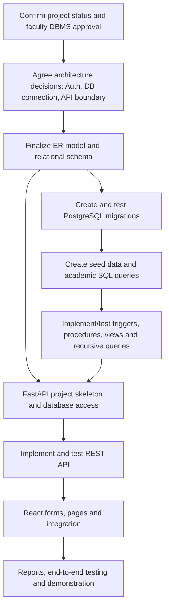

Migrations and database design are dependencies for reliable backend integration. React wireframes and learning may begin earlier, but full frontend integration should follow a stable database/API contract (v0.2 Sections 13.5–13.6).

### 18.2 Team work allocation

| Member | First architecture/design tasks | Later implementation tasks |
|---|---|---|
| R1 — Project lead and integration | Coordinate pending decisions; maintain ADRs; coordinate faculty confirmation and requirements traceability | Integration, diagrams, documentation, review, demo and release coordination |
| R2 — Database design and SQL | Review data responsibilities, history model, evidence rules, impact semantics and database interfaces | ER/schema, migrations, constraints, seed data, queries, views, triggers, procedures and SQL tests |
| R3 — Backend | Review API catalogue, authentication, authorization, connection and error contracts | FastAPI routers, services, repositories, psycopg, token verification, transactions and API tests |
| R4 — Frontend | Prepare wireframes, page hierarchy, five form plans, API expectations and React learning | React pages/components/forms, API client, dashboards, investigations, reports and UI tests |

### 18.3 Team decisions to settle before implementation

- [ ] D-01: Written faculty approval for PostgreSQL/Supabase or documented fallback.
- [ ] D-05: Supabase Auth or application-managed authentication.
- [ ] D-06: Data API disabled or sufficiently restricted; optional Supabase features.
- [ ] D-07: Direct connection or session/transaction pooler, based on actual network test.
- [ ] D-08: Supported React, Python, FastAPI, Psycopg and PostgreSQL versions.
- [ ] D-09: Local-only versus hosted frontend/backend deployment.
- [ ] D-13: Names assigned to R1–R4.
- [ ] D-18/D-22: Evidence enforcement, trigger concurrency and actor-context mechanism.
- [ ] API catalogue reviewed by R1–R4 and mapped to v0.2 FRs.
- [ ] Database Schema Document created before finalizing SQL implementation.

### 18.4 Architecture acceptance checklist

- [ ] React is the browser presentation layer.
- [ ] FastAPI is the only application-data API boundary.
- [ ] Browser does not connect directly to PostgreSQL.
- [ ] Database secrets are backend-only.
- [ ] Authentication and authorization are distinct and defined.
- [ ] Backend derives actor identity from a verified token.
- [ ] Actor context is transaction-scoped or passed through an approved procedure interface.
- [ ] Database constraints, triggers, views and procedures remain actual PostgreSQL objects.
- [ ] Root-cause and blast-radius queries are database-backed and cycle-safe.
- [ ] API endpoints map to functional requirements.
- [ ] Supabase Data API exposure is reviewed and tested.
- [ ] Migration files are version-controlled and reproducible.
- [ ] Pending choices remain clearly marked and are not presented as accepted.

---

## 19. References

Technical references consulted on **1 November 2026**. These links support technical statements in this document; they do not establish faculty approval of PostgreSQL or any academic requirement.

| Ref | Source | Used for |
|---|---|---|
| R1 | [Supabase — Connect to your database](https://supabase.com/docs/guides/database/connecting-to-postgres) | Direct, session-pooler and transaction-pooler selection; IP support; prepared-statement limitations; SSL |
| R2 | [Supabase — Connection pooling and limits](https://supabase.com/docs/guides/database/connecting-to-postgres/pooling-and-limits) | Application-side/server-side pooling and connection-limit considerations |
| R3 | [Supabase — Securing your data](https://supabase.com/docs/guides/database/secure-data) | Publishable versus secret/service-role keys; RLS; Data API and direct database access |
| R4 | [FastAPI — Security: First Steps](https://fastapi.tiangolo.com/tutorial/security/first-steps/) | Bearer token extraction and security dependencies |
| R5 | [FastAPI — Bigger Applications: Multiple Files](https://fastapi.tiangolo.com/tutorial/bigger-applications/) | APIRouter organization and shared dependencies |
| R6 | [Supabase — JWT Signing Keys](https://supabase.com/docs/guides/auth/signing-keys) | JWT signing keys and JWKS verification concepts |
| R7 | [Supabase — Deploy database migrations](https://supabase.com/docs/guides/deployment/database-migrations) | Version-controlled migrations, local testing, remote deployment and team workflow |
| R8 | [Psycopg 3 — Basic module usage](https://www.psycopg.org/psycopg3/docs/basic/usage.html) | Python PostgreSQL connections, parameters, transactions and sync/async APIs |
| R9 | [React — Thinking in React](https://react.dev/learn/thinking-in-react) | Component hierarchy, one-way data flow and building a UI from components |
| R10 | [React — Managing State](https://react.dev/learn/managing-state) | State structure, sharing state and lifting state up |
| R11 | [PostgreSQL 18 — CREATE PROCEDURE](https://www.postgresql.org/docs/current/sql-createprocedure.html) | Procedure definition and `CALL` behavior |
| R12 | [PostgreSQL 15 — CREATE TRIGGER](https://www.postgresql.org/docs/15/sql-createtrigger.html) | A trigger is associated with a specified table/view and fires for configured events |
| R13 | [PostgreSQL 18 — WITH Queries / Recursive Queries](https://www.postgresql.org/docs/current/queries-with.html) | Recursive CTE evaluation, traversal paths and cycle detection |

---

## 20. Architecture Summary and Handoff to Database Design

### 20.1 Summary

The proposed CAMPUS MEMORY architecture uses React for the user interface, FastAPI for authentication/authorization and application orchestration, and Supabase-hosted PostgreSQL for relational persistence and database-level logic. The browser calls FastAPI for application data. FastAPI validates the caller and request, then executes parameterized SQL or calls PostgreSQL procedures. PostgreSQL enforces integrity, records event status history through TG-1, applies relationship/evidence controls through the TG-2 design, and runs recursive investigation queries.

### 20.2 Pending decisions carried forward

| Decision | Required before | Current status |
|---|---|---|
| D-01 PostgreSQL/Supabase faculty approval | Treating DBMS choice as academically compliant | Not confirmed |
| D-05 Authentication and authorization scope | Implementing login and protected routes | Pending team decision |
| D-06 Supabase optional services/Data API exposure | Opening the database to application traffic | Pending team decision |
| D-07 Direct/session/transaction connection | Backend integration test | Pending network test |
| D-08 Exact dependency/runtime versions | Creating lockfiles and deployment instructions | Pending team decision |
| D-09 Hosting/deployment approach | Hosted demonstration | Pending team decision |
| D-13 Named team-role assignment | Work allocation | Pending team decision |
| D-18 Evidence concurrency/cascade behavior | TG-2 implementation | Pending schema design |
| D-22 Trigger actor context and procedure output | TG-1/SP-1 implementation | Pending schema design |

All other D-01 to D-22 items in Planning Document v0.2 remain in force. This document does not replace or close them.

### 20.3 Dependencies for the Database Schema Document

The database design can now proceed using these architecture constraints:

1. Use PostgreSQL as the proposed DBMS, but retain D-01 approval warning.
2. Use `campus_event` as the proposed general event table name, consistent with v0.2 terminology.
3. Keep relationship, evidence, impact, status-history and relationship-history responsibilities distinct in the logical model where the final schema requires them.
4. Design the schema so TG-1 can capture initial and changed statuses exactly once.
5. Design TG-2 as a logical evidence-enforcement rule, recognizing that separate trigger definitions may be needed on different tables.
6. Design SP-1 and SP-2 as real PostgreSQL stored procedures called by FastAPI.
7. Support recursive CTEs for upstream and downstream relationship traversal, with explicit cycle handling.
8. Preserve impact verification/estimation and affected-object references so the v0.2 counting rule can be implemented transparently.
9. Support role mapping and a trusted actor context without accepting an unverified browser-provided user ID.
10. Define PK/FK/check/unique constraints, indexes and grants in the Database Schema Document.

### 20.4 Handoff checklist for the four members

- [ ] R1 reviews the architecture and confirms unresolved faculty/project questions.
- [ ] R2 uses Sections 5.4, 8, 9.5 and 20.3 as constraints for the ER model and schema.
- [ ] R3 reviews Sections 7–10 and confirms the API, token and database-connection contracts.
- [ ] R4 reviews Section 6 and drafts the React page/form wireframes.
- [ ] All four review the diagrams and agree the same event terminology and API boundary.
- [ ] Architecture decisions are updated when the team makes a final choice; do not mark an ADR accepted before it is agreed.

---

*End of document. Status: v1.0 proposed architecture — pending team review, pending applicable faculty decisions, and not yet implemented.*
