# CAMPUS MEMORY — Database Schema Design Document

| Field | Value |
|---|---|
| **Project** | CAMPUS MEMORY — Temporal Campus Event-Provenance Database |
| **Course** | Database Systems — 24CS520 |
| **Document** | `CAMPUS_MEMORY_Database_Schema_v1.0.md` |
| **Version / status** | v1.0 — proposed relational design; SQL implementation and tests are not claimed complete |
| **Planning baseline** | `CAMPUS_MEMORY_Planning_Document_v0.2.md` |
| **Architecture baseline** | `CAMPUS_MEMORY_Architecture_Design_v1.0.md` |
| **Date** | 1 November 2026 |
| **Team size** | 4 members |
| **Proposed DBMS** | PostgreSQL hosted on Supabase — faculty approval **NOT CONFIRMED** |

> **Important status notice:** This document is the proposed database design for CAMPUS MEMORY. The original CAMPUS MEMORY Project Overview and official 24CS520 guideline were not available when the planning and architecture documents were prepared. Academic requirements below remain **“Unverified — confirm against the official guideline.”** PostgreSQL/Supabase remains a preferred team stack, not a faculty-approved DBMS. No SQL in this document is claimed to have been executed, and no Supabase database is claimed to have been initialized.

---

## 0. How to Read This Document

### 0.1 Status labels

| Label | Meaning |
|---|---|
| **[C] Team decision** | Selected by the team; not a faculty approval. |
| **[A] Proposed design** | A recommended design that the team should review before implementation. |
| **[D] Pending decision** | A decision carried from Planning v0.2 or Architecture v1.0 that still needs team/faculty input. |
| **[U] Unverified academic item** | **Unverified — confirm against the official guideline.** |
| **[I] Implementation example** | SQL shown to make the design concrete; it must be tested against the chosen PostgreSQL/Supabase version before use. |

### 0.2 Document scope

This document defines the proposed relational model, entities, attributes, keys, constraints, relationships, normalization, indexing, temporal/history approach, database-side logic, views, recursive investigation-query design, synthetic-data scenarios, migration plan, and database tests.

It is the design baseline for later SQL migration files. It does not itself prove the database has been created, that a migration has run, or that a test has passed.

### 0.3 Related documents

| Document | Role |
|---|---|
| `CAMPUS_MEMORY_Planning_Document_v0.2.md` | Project scope, requirements FR/NFR, roles, pending decisions D-01 to D-22, academic requirement summary |
| `CAMPUS_MEMORY_Architecture_Design_v1.0.md` | React → FastAPI → Supabase PostgreSQL architecture, backend identity boundary, connection choices, security and migration workflow |
| This document | Relational database design and implementation blueprint |

### 0.4 Source validation

The planning and architecture documents state that the official Project Overview and 24CS520 guideline were unavailable. This database design therefore follows those two team documents and their supplied requirement summaries. It does not create faculty approval or close any open faculty question.

---

## 1. Database Overview

### 1.1 Purpose

The CAMPUS MEMORY database stores Campus Events and evidence-backed directed relationships between them. It supports investigation of recorded causes, downstream effects, impacts, event status history, relationship provenance, temporal status reconstruction, search and reporting.

The central example is:

**UPS failure → Network switch failure → Lab network outage → Lab session cancellation.**

The database stores this as a set of event records and directed relationship records. It does not infer causation from event timestamps. A relationship is entered by an authorized investigator and remains suspected until evidence is attached and the relationship is explicitly confirmed.

### 1.2 Database responsibilities

The PostgreSQL database is intended to be the authority for:

- Relational persistence and referential integrity.
- Primary keys, foreign keys, unique rules and check constraints.
- Controlled event categories, types, severity levels and statuses.
- Directed event relationships and evidence records.
- Event status history, including initial status and every genuine status change.
- Evidence-presence enforcement for confirmed relationships.
- Database views and stored procedures required by the project.
- Recursive upstream/downstream investigation queries.
- Impact aggregation inputs and indexed search/filter operations.

FastAPI validates the authenticated caller, enforces application permissions, sets trusted actor context within a transaction, and runs parameterized SQL or procedures. React does not connect directly to PostgreSQL.

### 1.3 Proposed schema namespaces

[ A ] Use `public` for application tables/views and a restricted schema such as `app_private` for helper functions, if the selected Supabase setup and privilege model support it. Do not expose helper functions or internal tables unnecessarily through the Supabase Data API. Exact schema grants are finalized during migration/security implementation.

### 1.4 Database choice and approval warning

> The supplied requirement summary lists Oracle, MySQL and MongoDB but does not explicitly list PostgreSQL. PostgreSQL/Supabase is the selected team preference and requires faculty confirmation (D-01). **Do not claim academic compliance until written approval or the official guideline confirms it.**

Supabase is a platform providing a PostgreSQL database; it is not a separate database engine. The Supabase database remains PostgreSQL. [R1]

---

## 2. Database Design Goals and Rules

| Goal | Design rule |
|---|---|
| Preserve event provenance | Store the event, relationship, evidence, actor and timestamps separately. |
| Prevent unsupported causation | A relationship defaults to `suspected`; the database blocks confirmation without evidence. |
| Avoid false causal assumptions | Never create relationships automatically from temporal proximity. |
| Preserve status history | An insert creates one initial status-history row; an actual status change creates one additional row. |
| Separate event time from record time | `started_at` / `ended_at` describe when the event occurred; `created_at` / `recorded_at` describe when the system recorded it. |
| Prevent duplicate graph results | Recursive queries return a reachable event once at minimum depth and stop revisiting a node in the same path. |
| Avoid duplicate impact totals | Apply the proposed de-duplication rule in Section 13 and disclose ambiguities. |
| Support the academic table summary | Proposed schema has more than six meaningful tables, each with a primary key and five or more attributes. **Unverified — confirm against the official guideline.** |
| Keep the model understandable | Use lookup/reference tables only where they improve data integrity; avoid unnecessary generic frameworks. |
| Preserve data origin | Events, relationships, evidence and impacts carry a data-class reference (`verified`, `public`, `synthetic`). |

---

## 3. Entity Inventory and Proposed Table Set

### 3.1 Proposed tables

The proposed model contains **24 tables**. The number is a design choice, not a claim that the faculty requires exactly 24. Lookup tables have real meanings and are not dummy tables added merely to reach a count.

| # | Table | Purpose | Main relationship role |
|---:|---|---|---|
| 1 | `app_user` | Application profile mapped to a verified identity-provider subject | Actor on records and audit/history rows |
| 2 | `app_role` | Controlled role catalogue | Role assigned to users |
| 3 | `user_role_assignment` | Assigns/revokes roles for users | Many-to-many user/role junction |
| 4 | `department` | Campus department reference | Owns services; associated with users, activities and impacts |
| 5 | `campus_location` | Hierarchical campus locations | Parent/child locations; event/asset/activity/impact location |
| 6 | `campus_asset` | Equipment and infrastructure assets | Located at a location; may be linked to events and impacts |
| 7 | `campus_service` | Campus services such as Wi-Fi or examination systems | Owned by a department; may be linked to events and impacts |
| 8 | `scheduled_activity` | Planned teaching/operational activity, such as a lab session | May be affected by an event and referenced by an impact |
| 9 | `event_category` | Technical, infrastructure, academic, operational categories | Parent of event types and event records |
| 10 | `event_type` | Controlled event-type catalogue | Belongs to exactly one category |
| 11 | `severity_level` | Controlled severity scale | Referenced by events |
| 12 | `event_status` | Controlled event lifecycle statuses | Referenced by events and history |
| 13 | `event_status_transition` | Allowed from→to status changes | Enforces the selected lifecycle rules |
| 14 | `relationship_status` | Confirmed, suspected, rejected/unrelated | Referenced by event relationships |
| 15 | `evidence_type` | Log, document, witness, ticket, photograph, etc. | Referenced by evidence records |
| 16 | `impact_type` | Disrupted session, students affected, downtime, damage, etc. | Referenced by event impacts |
| 17 | `measurement_unit` | Controlled quantity units | Referenced by impacts and impact-type defaults |
| 18 | `data_class` | Verified, public or synthetic origin | Referenced by records whose origin must be labelled |
| 19 | `campus_event` | Main Campus Event registry | Parent of relationships, status history and impacts |
| 20 | `event_relationship` | Directed cause→effect relationship | Links two Campus Events |
| 21 | `relationship_evidence` | Evidence supporting a relationship | Child of an event relationship |
| 22 | `event_impact` | Effect of one event on an object/group/service | Child of one Campus Event |
| 23 | `event_status_history` | Initial status and later status changes | Append-only history for one Campus Event |
| 24 | `relationship_history` | Status/confidence changes to a relationship | History for one event relationship |

### 3.2 Why candidate entities are included or not separated

- **Application users and roles** are separate because one user may have more than one role over time, and role assignment needs its own actor, date and revocation information.
- **Locations, assets, services and scheduled activities** are separate because they represent different real-world objects and have different attributes and lifecycle meanings.
- **Event category and event type** are separate so event types can be controlled within a category. A composite foreign key is used to prevent an event from selecting a type belonging to another category.
- **Causal relationships** are separate from impacts. A relationship says one event contributed to another; an impact records a consequence or measured effect.
- **Evidence** is separate from relationships so a relationship can have multiple evidence items.
- **Status history** is separate from the current status on `campus_event`. The current status supports efficient retrieval; the history reconstructs the status at a past time.
- **Relationship history** is separate from event status history because it records changes to a different entity and different kinds of values.
- A single generic `incident` table is not added. `campus_event` is the only record type for events, in line with Planning v0.2 Section 5.4. “Incident” is a technical/infrastructure subset, not a second table.

---

## 4. Entity Relationship Diagram

The following diagram is the proposed logical ER model. It must be kept synchronized with the final SQL migrations. The complete attribute dictionary is in Section 6.

```mermaid
erDiagram
    DEPARTMENT ||--o{ APP_USER : belongs_to
    APP_USER ||--o{ USER_ROLE_ASSIGNMENT : receives
    APP_ROLE ||--o{ USER_ROLE_ASSIGNMENT : assigned_as
    APP_USER ||--o{ USER_ROLE_ASSIGNMENT : assigned_by

    CAMPUS_LOCATION ||--o{ CAMPUS_LOCATION : contains
    CAMPUS_LOCATION ||--o{ CAMPUS_ASSET : hosts
    DEPARTMENT ||--o{ CAMPUS_SERVICE : owns
    DEPARTMENT ||--o{ SCHEDULED_ACTIVITY : schedules
    CAMPUS_LOCATION ||--o{ SCHEDULED_ACTIVITY : hosts
    APP_USER ||--o{ SCHEDULED_ACTIVITY : creates

    EVENT_CATEGORY ||--o{ EVENT_TYPE : classifies
    EVENT_CATEGORY ||--o{ CAMPUS_EVENT : categorizes
    EVENT_TYPE ||--o{ CAMPUS_EVENT : specifies
    SEVERITY_LEVEL ||--o{ CAMPUS_EVENT : rates
    EVENT_STATUS ||--o{ CAMPUS_EVENT : current_status
    CAMPUS_LOCATION ||--o{ CAMPUS_EVENT : located_at
    CAMPUS_ASSET ||--o{ CAMPUS_EVENT : concerns
    CAMPUS_SERVICE ||--o{ CAMPUS_EVENT : concerns
    SCHEDULED_ACTIVITY ||--o{ CAMPUS_EVENT : affects
    APP_USER ||--o{ CAMPUS_EVENT : reports
    DATA_CLASS ||--o{ CAMPUS_EVENT : labels

    CAMPUS_EVENT ||--o{ EVENT_RELATIONSHIP : cause_or_effect
    RELATIONSHIP_STATUS ||--o{ EVENT_RELATIONSHIP : classifies
    APP_USER ||--o{ EVENT_RELATIONSHIP : records
    EVENT_RELATIONSHIP ||--o{ RELATIONSHIP_EVIDENCE : supported_by
    EVIDENCE_TYPE ||--o{ RELATIONSHIP_EVIDENCE : types
    APP_USER ||--o{ RELATIONSHIP_EVIDENCE : records
    DATA_CLASS ||--o{ RELATIONSHIP_EVIDENCE : labels

    CAMPUS_EVENT ||--o{ EVENT_IMPACT : has
    IMPACT_TYPE ||--o{ EVENT_IMPACT : classifies
    MEASUREMENT_UNIT ||--o{ EVENT_IMPACT : measures
    CAMPUS_LOCATION ||--o{ EVENT_IMPACT : affected_location
    CAMPUS_ASSET ||--o{ EVENT_IMPACT : affected_asset
    CAMPUS_SERVICE ||--o{ EVENT_IMPACT : affected_service
    SCHEDULED_ACTIVITY ||--o{ EVENT_IMPACT : affected_activity
    DEPARTMENT ||--o{ EVENT_IMPACT : affected_department
    APP_USER ||--o{ EVENT_IMPACT : records
    DATA_CLASS ||--o{ EVENT_IMPACT : labels

    CAMPUS_EVENT ||--o{ EVENT_STATUS_HISTORY : has_status_history
    EVENT_STATUS ||--o{ EVENT_STATUS_HISTORY : old_or_new_status
    APP_USER ||--o{ EVENT_STATUS_HISTORY : changes
    EVENT_STATUS ||--o{ EVENT_STATUS_TRANSITION : from_or_to

    EVENT_RELATIONSHIP ||--o{ RELATIONSHIP_HISTORY : has_history
    RELATIONSHIP_STATUS ||--o{ RELATIONSHIP_HISTORY : old_or_new_status
    APP_USER ||--o{ RELATIONSHIP_HISTORY : changes
```



**Diagram note:** Mermaid diagrams do not express every composite foreign key or check constraint. Those are documented in Sections 5–8 and must be implemented in SQL.

---

## 5. Relational Schema Summary and Cardinalities

### 5.1 Main relationships

| Parent | Child | Cardinality | Rule |
|---|---|---|---|
| `app_user` | `user_role_assignment` | 1:M | A user may have several historical/active role assignments. |
| `app_role` | `user_role_assignment` | 1:M | A role may be assigned to many users. |
| `campus_location` | `campus_location` | 1:M | One parent location can contain many child locations. |
| `campus_location` | `campus_asset` | 1:M | One location may contain many assets. |
| `event_category` | `event_type` | 1:M | Each type belongs to one category. |
| `event_category` | `campus_event` | 1:M | Each Campus Event has one category. |
| `event_type` | `campus_event` | 1:M | Each Campus Event has one selected event type. |
| `campus_event` | `event_relationship` | 1:M as cause and 1:M as effect | A Campus Event may cause several events and may be caused by several events. Two foreign keys point back to `campus_event`. |
| `event_relationship` | `relationship_evidence` | 1:M | A relationship can have multiple evidence records. |
| `campus_event` | `event_impact` | 1:M | An event can record zero or many impacts. |
| `campus_event` | `event_status_history` | 1:M | One initial history row and one row per real status change. |
| `event_relationship` | `relationship_history` | 1:M | A relationship may have zero or many recorded changes. |

### 5.2 Many-to-many relationships

- Users ↔ roles: implemented through `user_role_assignment`.
- Campus Events ↔ Campus Events: implemented through `event_relationship`, which has two role-specific foreign keys (`cause_event_id`, `effect_event_id`).

### 5.3 Relational schema notation

`PK` = primary key; `FK` = foreign key; `UQ` = unique; `NN` = not null.

```text
DEPARTMENT(department_id PK, department_code UQ, name, description,
           contact_email, is_active, created_at, updated_at)

APP_USER(user_id PK, auth_subject UQ, auth_provider, email UQ,
         display_name, department_id FK, is_active, created_at, updated_at)

APP_ROLE(role_code PK, display_name, description, is_system_role,
         is_active, created_at)

USER_ROLE_ASSIGNMENT(assignment_id PK, user_id FK, role_code FK,
                     assigned_by FK, assigned_at, revoked_at, reason)

CAMPUS_LOCATION(location_id PK, location_code UQ, name, location_type,
                parent_location_id FK, description, is_active, created_at, updated_at)

CAMPUS_ASSET(asset_id PK, asset_code UQ, name, asset_type, location_id FK,
             manufacturer, model, asset_status, description, created_at, updated_at)

CAMPUS_SERVICE(service_id PK, service_code UQ, name, service_type,
                owner_department_id FK, description, service_status, created_at, updated_at)

SCHEDULED_ACTIVITY(activity_id PK, activity_code UQ, title, course_code,
                    department_id FK, location_id FK, starts_at, ends_at,
                    activity_status, created_by FK, created_at, updated_at)

EVENT_CATEGORY(category_code PK, display_name, description, is_active, sort_order, created_at)
EVENT_TYPE(event_type_id PK, category_code FK, type_code, display_name,
           description, is_active, sort_order, created_at, updated_at)
SEVERITY_LEVEL(severity_code PK, display_name, severity_rank UQ, description,
               is_active, created_at, updated_at)
EVENT_STATUS(status_code PK, display_name, description, sort_order,
              is_terminal, is_active, created_at)
EVENT_STATUS_TRANSITION(from_status_code PK/FK, to_status_code PK/FK,
                        requires_reason, is_active, description, created_at, updated_at)
RELATIONSHIP_STATUS(relationship_status_code PK, display_name, description,
                    is_traversable, sort_order, is_active, created_at)
EVIDENCE_TYPE(evidence_type_code PK, display_name, description,
              requires_reference, is_active, created_at)
IMPACT_TYPE(impact_type_code PK, display_name, description, default_unit_code FK,
            is_active, created_at, aggregation_note)
MEASUREMENT_UNIT(unit_code PK, display_name, symbol, dimension_code,
                 decimal_places, is_active, description)
DATA_CLASS(data_class_code PK, display_name, description,
           requires_permission, is_active, created_at)

CAMPUS_EVENT(event_id PK, event_code UQ, title, description, category_code FK,
             event_type_id FK, severity_code FK, status_code FK,
             location_id FK, asset_id FK, service_id FK, scheduled_activity_id FK,
             started_at, ended_at, data_class_code FK, source_note,
             created_by FK, created_at, last_modified_by FK, updated_at)

EVENT_RELATIONSHIP(relationship_id PK, cause_event_id FK, effect_event_id FK,
                   relationship_status_code FK, confidence_score, explanation,
                   temporal_override_reason, data_class_code FK,
                   created_by FK, created_at, last_modified_by FK, updated_at)

RELATIONSHIP_EVIDENCE(evidence_id PK, relationship_id FK, evidence_type_code FK,
                      description, source_reference, source_url, recorded_by FK,
                      recorded_at, data_class_code FK)

EVENT_IMPACT(impact_id PK, event_id FK, impact_type_code FK, affected_location_id FK,
             affected_asset_id FK, affected_service_id FK, affected_activity_id FK,
             affected_department_id FK, affected_object_description, quantity,
             unit_code FK, verification_status, estimate_basis, recorded_by FK,
             recorded_at, data_class_code FK)

EVENT_STATUS_HISTORY(history_id PK, event_id FK, old_status_code FK NULL,
                     new_status_code FK, changed_at, changed_by FK, reason, is_initial)

RELATIONSHIP_HISTORY(history_id PK, relationship_id FK, change_kind,
                      old_status_code FK NULL, new_status_code FK NULL,
                      old_confidence, new_confidence, changed_at,
                      changed_by FK, reason)
```

---

## 6. Data Dictionary

All IDs use UUIDs generated by PostgreSQL (`gen_random_uuid()`) unless the team adopts another consistent strategy. Use `TIMESTAMPTZ` for stored timestamps. The actual Supabase PostgreSQL version must be checked before migrations are written (D-08).

### 6.1 `app_user`

**Purpose:** Maps a trusted identity-provider subject to an application user profile. It does not assume whether Supabase Auth or application-managed authentication is selected (D-05). Passwords are not stored in this profile table.

| Attribute | Type | Key | Null? | Default / rule | Meaning |
|---|---|---|---|---|---|
| `user_id` | `uuid` | PK | No | `gen_random_uuid()` | Internal application user ID |
| `auth_subject` | `text` | UQ | No | — | Subject/identifier from the selected identity provider; resolved only from a verified token or trusted backend login |
| `auth_provider` | `text` | — | No | — | Provider label such as `supabase_auth` or `application_auth` |
| `email` | `text` | UQ | No | — | User email, normalized by application |
| `display_name` | `varchar(120)` | — | No | — | User-facing name |
| `department_id` | `uuid` | FK → `department` | Yes | — | Department association |
| `is_active` | `boolean` | — | No | `true` | Whether the application account is enabled |
| `created_at` | `timestamptz` | — | No | `now()` | Profile creation time |
| `updated_at` | `timestamptz` | — | No | `now()` | Last profile update |

**Design note:** `auth_subject` is unique to avoid mapping one external identity to multiple application users. Authentication provider choice and token verification remain Architecture D-05.

### 6.2 `app_role`

**Purpose:** Controlled list of application roles.

| Attribute | Type | Key | Null? | Default / rule | Meaning |
|---|---|---|---|---|---|
| `role_code` | `varchar(40)` | PK | No | — | Stable role key |
| `display_name` | `varchar(80)` | — | No | — | Role label |
| `description` | `text` | — | No | — | Role purpose |
| `is_system_role` | `boolean` | — | No | `true` | Identifies built-in roles |
| `is_active` | `boolean` | — | No | `true` | Whether it can be assigned |
| `created_at` | `timestamptz` | — | No | `now()` | Creation time |

Initial role codes: `administrator`, `event_reporter`, `event_investigator`, `decision_maker`.

### 6.3 `user_role_assignment`

**Purpose:** Many-to-many junction between users and roles, with assignment and revocation provenance.

| Attribute | Type | Key | Null? | Default / rule | Meaning |
|---|---|---|---|---|---|
| `assignment_id` | `uuid` | PK | No | `gen_random_uuid()` | Assignment row ID |
| `user_id` | `uuid` | FK → `app_user` | No | — | User receiving the role |
| `role_code` | `varchar(40)` | FK → `app_role` | No | — | Assigned role |
| `assigned_by` | `uuid` | FK → `app_user` | No | — | Administrator/trusted actor who assigned it |
| `assigned_at` | `timestamptz` | — | No | `now()` | Assignment time |
| `revoked_at` | `timestamptz` | — | Yes | — | Revocation time; null means active |
| `assignment_reason` | `text` | — | Yes | — | Reason or administrative note |

**Constraint:** `revoked_at IS NULL OR revoked_at >= assigned_at`. Add a partial unique index on `(user_id, role_code) WHERE revoked_at IS NULL` so a user cannot have duplicate active assignments of the same role.

### 6.4 `department`

| Attribute | Type | Key | Null? | Default / rule | Meaning |
|---|---|---|---|---|---|
| `department_id` | `uuid` | PK | No | `gen_random_uuid()` | Department ID |
| `department_code` | `varchar(30)` | UQ | No | — | Stable department code |
| `name` | `varchar(120)` | — | No | — | Department name |
| `description` | `text` | — | Yes | — | Description |
| `contact_email` | `text` | — | Yes | — | Optional departmental contact |
| `is_active` | `boolean` | — | No | `true` | Active reference flag |
| `created_at` | `timestamptz` | — | No | `now()` | Creation time |
| `updated_at` | `timestamptz` | — | No | `now()` | Last update |

### 6.5 `campus_location`

**Purpose:** Campus hierarchy, for example campus → building → floor → room/lab.

| Attribute | Type | Key | Null? | Default / rule | Meaning |
|---|---|---|---|---|---|
| `location_id` | `uuid` | PK | No | `gen_random_uuid()` | Location ID |
| `location_code` | `varchar(40)` | UQ | No | — | Stable location code |
| `name` | `varchar(140)` | — | No | — | Display name |
| `location_type` | `varchar(40)` | — | No | — | Campus, building, floor, room, lab, outdoor area, etc. |
| `parent_location_id` | `uuid` | FK → `campus_location` | Yes | — | Parent location for hierarchy |
| `description` | `text` | — | Yes | — | Details |
| `is_active` | `boolean` | — | No | `true` | Active reference flag |
| `created_at` | `timestamptz` | — | No | `now()` | Creation time |
| `updated_at` | `timestamptz` | — | No | `now()` | Last update |

Prevent a direct self-parent with `CHECK (parent_location_id IS DISTINCT FROM location_id)`. A cycle of multiple parent links should be prevented by application validation or a dedicated hierarchy trigger if hierarchy writes become user-editable.

### 6.6 `campus_asset`

**Purpose:** Equipment/infrastructure such as UPS units, network switches, routers, lab computers and projectors.

| Attribute | Type | Key | Null? | Default / rule | Meaning |
|---|---|---|---|---|---|
| `asset_id` | `uuid` | PK | No | `gen_random_uuid()` | Asset ID |
| `asset_code` | `varchar(50)` | UQ | No | — | Asset label/code |
| `name` | `varchar(140)` | — | No | — | Asset name |
| `asset_type` | `varchar(60)` | — | No | — | UPS, switch, computer, projector, etc. |
| `location_id` | `uuid` | FK → `campus_location` | Yes | — | Current location |
| `manufacturer` | `varchar(100)` | — | Yes | — | Manufacturer |
| `model` | `varchar(100)` | — | Yes | — | Model |
| `asset_status` | `varchar(40)` | — | No | `'active'` | Active, maintenance, retired, unknown |
| `description` | `text` | — | Yes | — | Notes |
| `created_at` | `timestamptz` | — | No | `now()` | Creation time |
| `updated_at` | `timestamptz` | — | No | `now()` | Last update |

### 6.7 `campus_service`

**Purpose:** Logical campus services such as campus Wi-Fi, learning platforms, examination systems, power distribution services, or network access.

| Attribute | Type | Key | Null? | Default / rule | Meaning |
|---|---|---|---|---|---|
| `service_id` | `uuid` | PK | No | `gen_random_uuid()` | Service ID |
| `service_code` | `varchar(50)` | UQ | No | — | Stable service code |
| `name` | `varchar(140)` | — | No | — | Service name |
| `service_type` | `varchar(60)` | — | No | — | Network, academic platform, power, etc. |
| `owner_department_id` | `uuid` | FK → `department` | Yes | — | Responsible department |
| `description` | `text` | — | Yes | — | Description |
| `service_status` | `varchar(40)` | — | No | `'active'` | Active, degraded, retired, unknown |
| `created_at` | `timestamptz` | — | No | `now()` | Creation time |
| `updated_at` | `timestamptz` | — | No | `now()` | Last update |

### 6.8 `scheduled_activity`

**Purpose:** Planned activity, such as a lab session or examination slot. It is not itself a Campus Event. An event such as a cancellation may reference it.

| Attribute | Type | Key | Null? | Default / rule | Meaning |
|---|---|---|---|---|---|
| `scheduled_activity_id` | `uuid` | PK | No | `gen_random_uuid()` | Activity ID |
| `activity_code` | `varchar(50)` | UQ | No | — | Timetable/activity code |
| `title` | `varchar(180)` | — | No | — | Activity title |
| `course_code` | `varchar(40)` | — | Yes | — | Course or subject code |
| `department_id` | `uuid` | FK → `department` | Yes | — | Responsible department |
| `location_id` | `uuid` | FK → `campus_location` | Yes | — | Planned location |
| `starts_at` | `timestamptz` | — | No | — | Planned start |
| `ends_at` | `timestamptz` | — | No | — | Planned end |
| `activity_status` | `varchar(40)` | — | No | `'scheduled'` | Scheduled, completed, cancelled, rescheduled |
| `created_by` | `uuid` | FK → `app_user` | No | — | User who registered activity |
| `created_at` | `timestamptz` | — | No | `now()` | Record time |
| `updated_at` | `timestamptz` | — | No | `now()` | Last update |

Constraint: `ends_at > starts_at`.

### 6.9 `event_category`

**Purpose:** Controlled top-level categories: technical, infrastructure, academic and operational.

| Attribute | Type | Key | Null? | Default / rule | Meaning |
|---|---|---|---|---|---|
| `category_code` | `varchar(40)` | PK | No | — | Stable category key |
| `display_name` | `varchar(80)` | — | No | — | Label |
| `description` | `text` | — | No | — | Category meaning |
| `is_active` | `boolean` | — | No | `true` | Whether new events can use it |
| `sort_order` | `smallint` | — | No | `0` | UI display order |
| `created_at` | `timestamptz` | — | No | `now()` | Creation time |

Suggested rows: `technical`, `infrastructure`, `academic`, `operational`.

### 6.10 `event_type`

**Purpose:** More specific type under an event category. For example, an infrastructure event may have a power failure or equipment fault type.

| Attribute | Type | Key | Null? | Default / rule | Meaning |
|---|---|---|---|---|---|
| `event_type_id` | `uuid` | PK | No | `gen_random_uuid()` | Event type ID |
| `category_code` | `varchar(40)` | FK → `event_category` | No | — | Parent category |
| `type_code` | `varchar(50)` | — | No | — | Stable code within category |
| `display_name` | `varchar(100)` | — | No | — | Type label |
| `description` | `text` | — | Yes | — | Type details |
| `is_active` | `boolean` | — | No | `true` | Whether selectable |
| `sort_order` | `smallint` | — | No | `0` | UI order |
| `created_at` | `timestamptz` | — | No | `now()` | Creation time |
| `updated_at` | `timestamptz` | — | No | `now()` | Last update |

Constraints: `UNIQUE(category_code, type_code)` and `UNIQUE(event_type_id, category_code)`. The second unique key supports a composite foreign key from `campus_event`, ensuring the selected type belongs to the selected category.

### 6.11 `severity_level`

| Attribute | Type | Key | Null? | Default / rule | Meaning |
|---|---|---|---|---|---|
| `severity_code` | `varchar(30)` | PK | No | — | Stable severity code |
| `display_name` | `varchar(60)` | — | No | — | Informational, low, medium, high, critical, etc. |
| `severity_rank` | `smallint` | UQ | No | — | Numeric ordering for comparison |
| `description` | `text` | — | Yes | — | Severity definition |
| `is_active` | `boolean` | — | No | `true` | Whether selectable |
| `created_at` | `timestamptz` | — | No | `now()` | Creation time |
| `updated_at` | `timestamptz` | — | No | `now()` | Last update |

### 6.12 `event_status`

**Purpose:** Controlled lifecycle vocabulary for Campus Events.

| Attribute | Type | Key | Null? | Default / rule | Meaning |
|---|---|---|---|---|---|
| `status_code` | `varchar(30)` | PK | No | — | Stable state key |
| `display_name` | `varchar(60)` | — | No | — | UI label |
| `description` | `text` | — | No | — | State meaning |
| `sort_order` | `smallint` | — | No | `0` | Display order |
| `is_terminal` | `boolean` | — | No | `false` | Whether normal workflow ends here |
| `is_active` | `boolean` | — | No | `true` | Whether available for new transitions |
| `created_at` | `timestamptz` | — | No | `now()` | Creation time |

Illustrative values from v0.2: `reported`, `investigating`, `resolved`, `closed`, `void`. Exact allowed lifecycle and transitions remain D-17.

### 6.13 `event_status_transition`

**Purpose:** Data-driven list of allowed event status transitions.

| Attribute | Type | Key | Null? | Default / rule | Meaning |
|---|---|---|---|---|---|
| `from_status_code` | `varchar(30)` | PK part, FK → `event_status` | No | — | Current status |
| `to_status_code` | `varchar(30)` | PK part, FK → `event_status` | No | — | Requested next status |
| `requires_reason` | `boolean` | — | No | `false` | Whether transition must have a reason |
| `is_active` | `boolean` | — | No | `true` | Whether transition is allowed |
| `description` | `text` | — | Yes | — | Transition rule |
| `created_at` | `timestamptz` | — | No | `now()` | Creation time |
| `updated_at` | `timestamptz` | — | No | `now()` | Last update |

Composite primary key: `(from_status_code, to_status_code)`. The initial proposed transition rows must be reviewed with the state diagram and D-17; do not invent them as faculty rules.

### 6.14 `relationship_status`

| Attribute | Type | Key | Null? | Default / rule | Meaning |
|---|---|---|---|---|---|
| `relationship_status_code` | `varchar(30)` | PK | No | — | Stable relationship state |
| `display_name` | `varchar(80)` | — | No | — | Label |
| `description` | `text` | — | No | — | Meaning |
| `is_traversable` | `boolean` | — | No | — | Whether investigation queries may follow it |
| `sort_order` | `smallint` | — | No | `0` | Display order |
| `is_active` | `boolean` | — | No | `true` | Whether selectable |
| `created_at` | `timestamptz` | — | No | `now()` | Creation time |

Suggested values: `suspected` (traversable only when caller chooses include-suspected), `confirmed` (traversable), `rejected_unrelated` (not traversable).

### 6.15 `evidence_type`

| Attribute | Type | Key | Null? | Default / rule | Meaning |
|---|---|---|---|---|---|
| `evidence_type_code` | `varchar(40)` | PK | No | — | Stable evidence type |
| `display_name` | `varchar(80)` | — | No | — | Log, photograph, document, witness, ticket, external reference, etc. |
| `description` | `text` | — | No | — | Type explanation |
| `requires_reference` | `boolean` | — | No | `false` | Whether source reference is required |
| `is_active` | `boolean` | — | No | `true` | Whether selectable |
| `created_at` | `timestamptz` | — | No | `now()` | Creation time |

### 6.16 `impact_type`

| Attribute | Type | Key | Null? | Default / rule | Meaning |
|---|---|---|---|---|---|
| `impact_type_code` | `varchar(40)` | PK | No | — | Stable impact key |
| `display_name` | `varchar(100)` | — | No | — | Students affected, sessions disrupted, downtime, asset damage, etc. |
| `description` | `text` | — | No | — | Impact meaning |
| `default_unit_code` | `varchar(20)` | FK → `measurement_unit` | Yes | — | Default measurement unit |
| `is_active` | `boolean` | — | No | `true` | Whether selectable |
| `created_at` | `timestamptz` | — | No | `now()` | Creation time |
| `aggregation_note` | `text` | — | Yes | — | Unit or aggregation guidance |

### 6.17 `measurement_unit`

| Attribute | Type | Key | Null? | Default / rule | Meaning |
|---|---|---|---|---|---|
| `unit_code` | `varchar(20)` | PK | No | — | Unit key |
| `display_name` | `varchar(80)` | — | No | — | Person, session, hour, minute, item, INR, etc. |
| `symbol` | `varchar(20)` | — | No | — | Unit symbol |
| `dimension_code` | `varchar(30)` | — | No | — | Count, time, currency, energy, etc. |
| `decimal_places` | `smallint` | — | No | `0` | Suggested display precision; check 0–6 |
| `is_active` | `boolean` | — | No | `true` | Whether selectable |
| `description` | `text` | — | Yes | — | Unit definition |

### 6.18 `data_class`

**Purpose:** Labels information as verified, public or synthetic in line with Planning v0.2 NFR-017 and Section 15.

| Attribute | Type | Key | Null? | Default / rule | Meaning |
|---|---|---|---|---|---|
| `data_class_code` | `varchar(20)` | PK | No | — | `verified`, `public`, `synthetic` |
| `display_name` | `varchar(60)` | — | No | — | User-facing label |
| `description` | `text` | — | No | — | Data-class meaning |
| `requires_permission` | `boolean` | — | No | `false` | Whether permission record is required before use |
| `is_active` | `boolean` | — | No | `true` | Whether selectable |
| `created_at` | `timestamptz` | — | No | `now()` | Creation time |

### 6.19 `campus_event`

**Purpose:** The single general record type for everything that happened on campus. “Incident” is a technical/infrastructure subset, not a separate entity/table.

| Attribute | Type | Key | Null? | Default / rule | Meaning |
|---|---|---|---|---|---|
| `event_id` | `uuid` | PK | No | `gen_random_uuid()` | Internal event identifier |
| `event_code` | `varchar(50)` | UQ | No | — | Human-readable event code |
| `title` | `varchar(200)` | — | No | — | Short event title |
| `description` | `text` | — | No | — | Event details |
| `category_code` | `varchar(40)` | FK → `event_category` | No | — | Technical/infrastructure/academic/operational |
| `event_type_id` | `uuid` | Composite FK → `event_type` | No | — | Specific type consistent with category |
| `severity_code` | `varchar(30)` | FK → `severity_level` | No | — | Severity |
| `status_code` | `varchar(30)` | FK → `event_status` | No | `'reported'` | Current lifecycle state |
| `location_id` | `uuid` | FK → `campus_location` | Yes | — | Associated location |
| `asset_id` | `uuid` | FK → `campus_asset` | Yes | — | Associated asset |
| `service_id` | `uuid` | FK → `campus_service` | Yes | — | Associated service |
| `scheduled_activity_id` | `uuid` | FK → `scheduled_activity` | Yes | — | Planned activity affected by event |
| `started_at` | `timestamptz` | — | No | — | When the event began/occurred |
| `ended_at` | `timestamptz` | — | Yes | — | When it ended/resolved, if known |
| `data_class_code` | `varchar(20)` | FK → `data_class` | No | — | Verified/public/synthetic label |
| `source_note` | `text` | — | Yes | — | How the event information was obtained |
| `created_by` | `uuid` | FK → `app_user` | No | — | Trusted creator identity |
| `created_at` | `timestamptz` | — | No | `now()` | Record creation time |
| `last_modified_by` | `uuid` | FK → `app_user` | No | — | Trusted last modifier identity |
| `updated_at` | `timestamptz` | — | No | `now()` | Last modification time |

Important constraints:
- `ended_at IS NULL OR ended_at >= started_at`.
- At least one of location, asset, service or scheduled activity must be linked. This is a proposed interpretation of the v0.2 event-location/asset requirement; review whether a campus-wide event needs a documented exception.
- `FOREIGN KEY (event_type_id, category_code)` references the matching pair in `event_type` so an event cannot pair an academic category with a technical-only type.
- Do not hard-delete event rows through the application. Use the agreed void/correction workflow (FR-006).

### 6.20 `event_relationship`

**Purpose:** Directed cause→effect link between two Campus Events.

| Attribute | Type | Key | Null? | Default / rule | Meaning |
|---|---|---|---|---|---|
| `relationship_id` | `uuid` | PK | No | `gen_random_uuid()` | Relationship ID |
| `cause_event_id` | `uuid` | FK → `campus_event` | No | — | Candidate cause event |
| `effect_event_id` | `uuid` | FK → `campus_event` | No | — | Candidate effect event |
| `relationship_status_code` | `varchar(30)` | FK → `relationship_status` | No | `'suspected'` | Confirmed/suspected/rejected-unrelated |
| `confidence_score` | `numeric(5,4)` | — | No | — | Confidence in range 0.0000–1.0000 |
| `explanation` | `text` | — | No | — | Human explanation of why the link is proposed |
| `temporal_override_reason` | `text` | — | Yes | — | Required if cause starts after effect (FR-014 warning override) |
| `data_class_code` | `varchar(20)` | FK → `data_class` | No | — | Verified/public/synthetic origin |
| `created_by` | `uuid` | FK → `app_user` | No | — | Investigator who recorded the relationship |
| `created_at` | `timestamptz` | — | No | `now()` | Creation time |
| `last_modified_by` | `uuid` | FK → `app_user` | No | — | Last modifier |
| `updated_at` | `timestamptz` | — | No | `now()` | Last update |

Constraints:
- `cause_event_id <> effect_event_id`.
- `UNIQUE(cause_event_id, effect_event_id)`; reverse direction is a different pair.
- `confidence_score BETWEEN 0 AND 1`.
- A new relationship defaults to `suspected`; direct insertion as `confirmed` is blocked by database trigger logic.
- Rejected/unrelated relationships remain stored for provenance but are excluded from root-cause/blast-radius traversal.

### 6.21 `relationship_evidence`

| Attribute | Type | Key | Null? | Default / rule | Meaning |
|---|---|---|---|---|---|
| `evidence_id` | `uuid` | PK | No | `gen_random_uuid()` | Evidence ID |
| `relationship_id` | `uuid` | FK → `event_relationship` | No | — | Relationship supported by evidence |
| `evidence_type_code` | `varchar(40)` | FK → `evidence_type` | No | — | Evidence type |
| `description` | `text` | — | No | — | What the evidence demonstrates |
| `source_reference` | `text` | — | Yes | — | Internal record/reference label |
| `source_url` | `text` | — | Yes | — | Optional external location; not a substitute for access control |
| `recorded_by` | `uuid` | FK → `app_user` | No | — | Trusted recorder |
| `recorded_at` | `timestamptz` | — | No | `now()` | Time added to database |
| `data_class_code` | `varchar(20)` | FK → `data_class` | No | — | Verified/public/synthetic origin |

Evidence records must not be hard-deleted if deletion would leave a confirmed relationship with no evidence. Source files, if stored outside the database, need a separate secure storage plan; this schema stores metadata/reference, not binary file contents.

### 6.22 `event_impact`

**Purpose:** Records an effect on a real-world object, group or resource. Each impact belongs to exactly one event.

| Attribute | Type | Key | Null? | Default / rule | Meaning |
|---|---|---|---|---|---|
| `impact_id` | `uuid` | PK | No | `gen_random_uuid()` | Impact record ID |
| `event_id` | `uuid` | FK → `campus_event` | No | — | Event that caused/recorded this impact |
| `impact_type_code` | `varchar(40)` | FK → `impact_type` | No | — | Impact category |
| `affected_location_id` | `uuid` | FK → `campus_location` | Yes | — | Affected location, if applicable |
| `affected_asset_id` | `uuid` | FK → `campus_asset` | Yes | — | Affected asset, if applicable |
| `affected_service_id` | `uuid` | FK → `campus_service` | Yes | — | Affected service, if applicable |
| `affected_activity_id` | `uuid` | FK → `scheduled_activity` | Yes | — | Affected scheduled activity, if applicable |
| `affected_department_id` | `uuid` | FK → `department` | Yes | — | Affected department, if applicable |
| `affected_object_description` | `text` | — | Yes | — | Required if no structured affected-object FK is provided |
| `quantity` | `numeric(14,3)` | — | No | — | Measured/estimated quantity; non-negative |
| `unit_code` | `varchar(20)` | FK → `measurement_unit` | No | — | Measurement unit |
| `verification_status` | `varchar(20)` | — | No | — | `verified` or `estimated` |
| `estimate_basis` | `text` | — | Yes | — | Required when status is estimated |
| `recorded_by` | `uuid` | FK → `app_user` | No | — | Trusted recorder |
| `recorded_at` | `timestamptz` | — | No | `now()` | Record time |
| `data_class_code` | `varchar(20)` | FK → `data_class` | No | — | Verified/public/synthetic source class |

Constraints:
- `quantity >= 0`.
- `verification_status IN ('verified','estimated')`.
- If `verification_status = 'estimated'`, `estimate_basis` must be non-empty.
- At most one structured affected-object FK may be non-null. If all five are null, `affected_object_description` must be non-empty. This explicitly preserves v0.2's rule that unreferenced impacts may exist but must be flagged as not deduplicated.
- Do not sum different unit dimensions (e.g., students and hours) into one numeric total.

### 6.23 `event_status_history`

**Purpose:** Append-only history of the initial status and every genuine status change for a Campus Event.

| Attribute | Type | Key | Null? | Default / rule | Meaning |
|---|---|---|---|---|---|
| `history_id` | `uuid` | PK | No | `gen_random_uuid()` | History row ID |
| `event_id` | `uuid` | FK → `campus_event` | No | — | Event whose status changed |
| `old_status_code` | `varchar(30)` | FK → `event_status` | Yes | — | Null for initial status row |
| `new_status_code` | `varchar(30)` | FK → `event_status` | No | — | New/current status |
| `changed_at` | `timestamptz` | — | No | `clock_timestamp()` | Actual history-write time |
| `changed_by` | `uuid` | FK → `app_user` | No | — | Trusted actor from backend transaction context |
| `reason` | `text` | — | No | — | Initial-status note or required change reason |
| `is_initial` | `boolean` | — | No | `false` | True only for the initial status row |

The trigger must ensure exactly one initial status entry per event and must not write a new row if the status value did not change. Runtime application role must not update or delete history rows.

### 6.24 `relationship_history`

**Purpose:** Preserves changes to relationship status and/or confidence (FR-016, Should priority).

| Attribute | Type | Key | Null? | Default / rule | Meaning |
|---|---|---|---|---|---|
| `history_id` | `uuid` | PK | No | `gen_random_uuid()` | History row ID |
| `relationship_id` | `uuid` | FK → `event_relationship` | No | — | Relationship changed |
| `change_kind` | `varchar(30)` | — | No | — | Status, confidence or both |
| `old_status_code` | `varchar(30)` | FK → `relationship_status` | Yes | — | Previous status |
| `new_status_code` | `varchar(30)` | FK → `relationship_status` | Yes | — | New status |
| `old_confidence` | `numeric(5,4)` | — | Yes | — | Previous confidence |
| `new_confidence` | `numeric(5,4)` | — | Yes | — | New confidence |
| `changed_at` | `timestamptz` | — | No | `clock_timestamp()` | Change time |
| `changed_by` | `uuid` | FK → `app_user` | No | — | Trusted actor |
| `reason` | `text` | — | No | — | Why the relationship was changed; required for downgrade |

**Implementation status:** The table is included in the proposed model. Whether relationship-history writes are implemented by a separate trigger in the first version remains a team design decision. The recommended approach is a trigger so all changes, including SQL Editor changes, are captured; see Section 11.6.

---

## 7. Academic Attribute-Count Matrix

The supplied summary says at least six tables, primary keys and foreign keys where applicable, and at least five attributes per table. This summary remains **Unverified — confirm against the official guideline.** The proposed tables below all have at least five meaningful attributes.

| Table | Attribute count | Primary key | Foreign keys (where applicable) | Purpose |
|---|---:|---|---|---|
| `app_user` | 9 | `user_id` | `department_id` | User profile |
| `app_role` | 6 | `role_code` | — | Role catalogue |
| `user_role_assignment` | 7 | `assignment_id` | user, role, assigned_by | User-role history |
| `department` | 8 | `department_id` | — | Department reference |
| `campus_location` | 9 | `location_id` | parent location | Location hierarchy |
| `campus_asset` | 10 | `asset_id` | location | Equipment reference |
| `campus_service` | 9 | `service_id` | owner department | Service reference |
| `scheduled_activity` | 12 | `scheduled_activity_id` | department, location, creator | Planned activity |
| `event_category` | 6 | `category_code` | — | Event category |
| `event_type` | 9 | `event_type_id` | category | Event type |
| `severity_level` | 7 | `severity_code` | — | Severity reference |
| `event_status` | 7 | `status_code` | — | Event status reference |
| `event_status_transition` | 7 | `(from_status_code, to_status_code)` | two event statuses | Allowed lifecycle transitions |
| `relationship_status` | 7 | `relationship_status_code` | — | Relationship status |
| `evidence_type` | 6 | `evidence_type_code` | — | Evidence type |
| `impact_type` | 7 | `impact_type_code` | default unit | Impact type |
| `measurement_unit` | 7 | `unit_code` | — | Measurement unit |
| `data_class` | 6 | `data_class_code` | — | Data origin label |
| `campus_event` | 20 | `event_id` | category/type/severity/status/location/asset/service/activity/data class/users | Event registry |
| `event_relationship` | 12 | `relationship_id` | cause/effect/status/data class/users | Directed causal link |
| `relationship_evidence` | 9 | `evidence_id` | relationship/type/recorder/data class | Evidence item |
| `event_impact` | 17 | `impact_id` | event/type/target objects/unit/recorder/data class | Event consequence |
| `event_status_history` | 8 | `history_id` | event/old status/new status/actor | Status audit |
| `relationship_history` | 10 | `history_id` | relationship/old status/new status/actor | Relationship audit |

Counts include all listed columns, including primary-key and foreign-key attributes. If the official guideline defines “attribute” differently, revise the matrix after checking it.

---

## 8. Key Constraints and Referential Actions

### 8.1 Primary keys

- Use UUID primary keys for main transactional entities and user records. UUIDs reduce dependence on sequential IDs and simplify merging local synthetic datasets.
- Use short text codes for stable lookup values such as `category_code`, `status_code`, `role_code` and `unit_code`.
- Use a composite key for `event_status_transition` because each from→to pair must be unique.

### 8.2 Foreign-key deletion policy

The default policy is **RESTRICT / NO ACTION**, not cascading deletion, for event, relationship, evidence, impact and history records.

| Relationship | Proposed delete behavior | Reason |
|---|---|---|
| Department → users/services/activities | RESTRICT | Preserve ownership references |
| Location → assets/events/activities/impacts | RESTRICT | Avoid orphaning historical records |
| Asset/service/activity → events/impacts | RESTRICT | Preserve event context |
| Event → relationships/impacts/status history | RESTRICT | Events are voided, not hard-deleted |
| Event relationship → evidence/history | RESTRICT | Preserve provenance and investigation history |
| Lookup row → records | RESTRICT | Deactivate lookup values instead of deleting referenced values |
| User → authored/history records | RESTRICT | Keep actor attribution stable; deactivate user instead |

Do not use `ON DELETE CASCADE` on event history or relationship evidence. The evidence rule depends on preserving proof attached to confirmed relationships.

### 8.3 Required uniqueness rules

- `app_user.auth_subject` unique.
- `app_user.email` unique after normalization.
- `department.department_code` unique.
- `campus_location.location_code` unique.
- `campus_asset.asset_code` unique.
- `campus_service.service_code` unique.
- `scheduled_activity.activity_code` unique.
- `(category_code, type_code)` unique in `event_type`.
- `(cause_event_id, effect_event_id)` unique in `event_relationship`.
- Active `(user_id, role_code)` assignment unique through partial unique index.

### 8.4 Core check constraints

- Event end time cannot precede start time.
- Scheduled activity end time must be later than start time.
- Event relationship cannot point to itself.
- Relationship confidence must be from 0 to 1 inclusive.
- Event impact quantity must be non-negative.
- Event impact verification state must be `verified` or `estimated`.
- An estimated impact must have a non-empty estimate basis.
- An impact may refer to at most one structured affected object. If none is linked, a textual affected-object description is required.
- A parent location cannot be itself.
- Relationship downgrade to suspected/rejected requires a non-empty reason (database-side enforcement).
- A confirmed relationship must have at least one evidence record.

### 8.5 Composite category/type validation

`campus_event` stores both `category_code` and `event_type_id` for convenient filtering and readable reporting. To avoid an inconsistent pair, `event_type` has `UNIQUE(event_type_id, category_code)` and `campus_event` has a composite foreign key referencing both values. A simple foreign key on `event_type_id` alone would not prevent a type/category mismatch.

---

## 9. Normalization

### 9.1 First Normal Form (1NF)

Each column contains a single value. Multiple evidence items are not stored as a comma-separated list; they are separate rows in `relationship_evidence`. Multiple roles are not stored as a list in `app_user`; they are separate rows in `user_role_assignment`. A Campus Event with multiple causal links uses multiple `event_relationship` rows.

### 9.2 Second Normal Form (2NF)

Non-key columns in the junction and history entities depend on the whole key. `event_status_transition` uses a composite key `(from_status_code, to_status_code)`; transition attributes describe that exact pair. `user_role_assignment` has a surrogate key, with uniqueness applied to the active user/role pair.

### 9.3 Third Normal Form (3NF)

Descriptive values are stored in reference tables where they are stable shared facts:

- Category descriptions in `event_category`.
- Type descriptions in `event_type`.
- Severity ordering in `severity_level`.
- Status meanings in `event_status` and `relationship_status`.
- Units in `measurement_unit`.
- Role labels in `app_role`.

For example, event records store `severity_code`, not repeated severity descriptions and ranks.

### 9.4 Intentional current-state duplication

`campus_event.status_code` duplicates the latest state also represented by `event_status_history`. This is intentional: the current status can be fetched directly without searching the complete history for every event list. The history table remains the source for as-of status reconstruction and auditing. The trigger is responsible for keeping both consistent.

`campus_event.last_modified_by` and `updated_at` store only the most recent modification, as required by FR-005. They do not reconstruct old field values. Full field-level audit is excluded from v1 unless D-15 changes scope (FR-050).

---

## 10. Temporal and Provenance Design

### 10.1 Event time versus record time

| Column | Meaning |
|---|---|
| `campus_event.started_at` | When the event began/occurred |
| `campus_event.ended_at` | When it ended/resolved, if known |
| `campus_event.created_at` | When the event was first entered into CAMPUS MEMORY |
| `campus_event.updated_at` | When the event record was last modified |
| `event_status_history.changed_at` | When a status value was recorded as changing |
| `relationship_evidence.recorded_at` | When evidence was added to the database |

Store timestamps as `TIMESTAMPTZ`; present them in the application in India Standard Time, while preserving the instant. Avoid storing local-time strings without a time zone.

### 10.2 “As of” status reconstruction

The database can reconstruct the status of an event at a chosen timestamp by selecting the most recent `event_status_history` row where `changed_at <= requested_time`, ordered newest-first. If no history row exists before that time, the event had not yet been recorded in the system by that timestamp.

This supports **status as recorded at a point in time**. It does not reconstruct historical title, description, severity or location values because v1 does not include full field-level audit history (FR-050).

### 10.3 Provenance fields

Every causal relationship records:
- Who entered it (`created_by`).
- When it was entered (`created_at`).
- Its direction (`cause_event_id` → `effect_event_id`).
- Its current assessment (`relationship_status_code`).
- Its confidence (`confidence_score`).
- The explanation (`explanation`).
- Evidence rows (`relationship_evidence`).

The system should describe an upstream event with no recorded incoming causes as the **“root of the recorded chain”**, not as an absolute root cause.

### 10.4 Trusted actor context

The architecture recommends transaction-local database context set by FastAPI after token verification and authorization. A custom setting such as `app.actor_id` may carry the trusted internal `app_user.user_id` into database triggers. `set_config(..., true)` makes the value transaction-local; PostgreSQL documents `current_setting` and `set_config` for reading and setting configuration values. [R10]

Proposed transaction sequence:

1. FastAPI verifies the bearer token and resolves its trusted subject to `app_user.user_id`.
2. FastAPI opens a database transaction.
3. FastAPI sets `app.actor_id` and, for a status/relationship change, `app.change_reason` using parameterized values and transaction-local scope.
4. FastAPI performs the SQL write or calls a procedure on the same connection/transaction.
5. Trigger functions read the trusted context and record the actor/reason.
6. The transaction commits or rolls back as a unit.

**Security limitation:** a custom PostgreSQL setting is context propagation, not cryptographic identity proof. A party that has the database password can set its own custom value. Keep database credentials backend-only, use a least-privilege runtime role, and only let FastAPI set actor context after verifying the token. Direct SQL Editor tests must use explicit synthetic test actors.

---

## 11. Database Triggers and Stored Procedures

### 11.1 Trigger inventory and count distinction

Planning v0.2 describes two **logical trigger designs** (TG-1 and TG-2). In PostgreSQL, a trigger definition is attached to a specific table. Since TG-1 has different insert and update events, and TG-2 protects more than one table, the physical implementation may require more than two `CREATE TRIGGER` definitions.

| Logical design | Physical trigger definition | Table/event | Purpose | Academic count status |
|---|---|---|---|---|
| TG-1 | `trg_event_status_history_after_insert` | `campus_event AFTER INSERT` | Record initial status | Part of TG-1; faculty counting basis unverified |
| TG-1 | `trg_event_status_history_after_status_update` | `campus_event AFTER UPDATE OF status_code` | Record actual status change only | Part of TG-1; faculty counting basis unverified |
| TG-2A | `trg_relationship_confirm_requires_evidence` | `event_relationship BEFORE INSERT/UPDATE` (separate trigger definitions if needed) | Reject direct/unsupported confirmation | Part of TG-2 |
| TG-2B | `trg_evidence_protect_last_confirmed` | `relationship_evidence BEFORE DELETE` | Block deletion of last evidence for a confirmed relationship | Part of TG-2 |
| TG-2B | `trg_evidence_protect_reassignment` | `relationship_evidence BEFORE UPDATE OF relationship_id` | Block moving last evidence away from a confirmed relationship | Part of TG-2 |
| TG-3 [A] | `trg_relationship_history_after_change` | `event_relationship AFTER UPDATE OF status/confidence` | Capture relationship history if FR-016 is implemented in v1 | Additional, optional |
| Metadata helper [A] | `trg_event_metadata_before_write` | `campus_event BEFORE INSERT/UPDATE` | Set actor and timestamps for FR-005 | Additional, optional/recommended |

**Academic warning:** the supplied summary asks for two triggers, but it does not define whether the faculty counts logical behaviors or physical trigger definitions. **Unverified — confirm against the official guideline.** Demonstrate each actual `CREATE TRIGGER` definition in PostgreSQL and document the count transparently.

### 11.2 TG-1 — Event status history

**Goal:** create exactly one initial status history row on event creation and exactly one additional history row for every actual status change. No row is created for a title-only edit or setting the same status again (FR-033).

**Design:**
- An `AFTER INSERT` trigger inserts the initial status row (`old_status_code = NULL`, `new_status_code = NEW.status_code`, `is_initial = true`).
- An `AFTER UPDATE OF status_code` trigger uses `WHEN (OLD.status_code IS DISTINCT FROM NEW.status_code)` and inserts old/new statuses.
- Both use the actor context from `app.actor_id`.
- For a real status change, a non-empty `app.change_reason` is required.
- `event_status_history` is append-only for the runtime application role.
- The stored procedures do not write history directly; TG-1 is the only writer (single-writer rule).

**Illustrative helper function pattern [I]:**

```sql
-- Illustrative only; verify schema names and permissions before migration.
CREATE OR REPLACE FUNCTION app_private.current_actor_id()
RETURNS uuid
LANGUAGE plpgsql
STABLE
AS $$
DECLARE
    v_actor text := current_setting('app.actor_id', true);
BEGIN
    IF v_actor IS NULL OR btrim(v_actor) = '' THEN
        RAISE EXCEPTION 'Trusted app.actor_id context is required'
            USING ERRCODE = '42501';
    END IF;
    RETURN v_actor::uuid;
END;
$$;
```

**Initial insert trigger function pattern [I]:**

```sql
CREATE OR REPLACE FUNCTION app_private.write_initial_event_status()
RETURNS trigger
LANGUAGE plpgsql
AS $$
BEGIN
    INSERT INTO public.event_status_history
        (event_id, old_status_code, new_status_code,
         changed_at, changed_by, reason, is_initial)
    VALUES
        (NEW.event_id, NULL, NEW.status_code,
         clock_timestamp(), app_private.current_actor_id(),
         'Initial status', true);
    RETURN NEW;
END;
$$;
```

**Status update trigger function pattern [I]:**

```sql
CREATE OR REPLACE FUNCTION app_private.write_event_status_change()
RETURNS trigger
LANGUAGE plpgsql
AS $$
DECLARE
    v_reason text := current_setting('app.change_reason', true);
BEGIN
    IF OLD.status_code IS DISTINCT FROM NEW.status_code THEN
        IF v_reason IS NULL OR btrim(v_reason) = '' THEN
            RAISE EXCEPTION 'A reason is required for an event status change'
                USING ERRCODE = '23514';
        END IF;

        INSERT INTO public.event_status_history
            (event_id, old_status_code, new_status_code,
             changed_at, changed_by, reason, is_initial)
        VALUES
            (NEW.event_id, OLD.status_code, NEW.status_code,
             clock_timestamp(), app_private.current_actor_id(),
             btrim(v_reason), false);
    END IF;
    RETURN NEW;
END;
$$;
```

Attach the first function to `AFTER INSERT ON public.campus_event`. Attach the second to `AFTER UPDATE OF status_code ON public.campus_event` with a `WHEN` clause for distinct old/new status. Do not create a second writer in `register_event` or `close_event`.

### 11.3 Last-modified metadata (FR-005)

`campus_event.created_by`, `created_at`, `last_modified_by` and `updated_at` retain creator and last-modifier metadata. The architecture suggests a `BEFORE INSERT OR UPDATE` metadata trigger that reads `app.actor_id` and timestamps the write, or an equally reliable backend-managed approach. A trigger is recommended so direct SQL operations cannot silently leave metadata stale. This metadata is not field-level audit: old title/description/severity values are not retained in v1.

### 11.4 TG-2A — Confirmation requires evidence

**Goal:** a relationship can become `confirmed` only if at least one evidence row exists at the time of confirmation. Direct insertion as confirmed is rejected; new relationships default to suspected.

**Required behavior:**
- Before inserting an `event_relationship`, reject `relationship_status_code = 'confirmed'`.
- Before changing a relationship to `confirmed`, verify at least one `relationship_evidence` row exists.
- When a relationship is downgraded from confirmed to suspected/rejected, require a non-empty reason and preserve it in `relationship_history`.
- FastAPI may pre-check for a friendly message but PostgreSQL remains authoritative.

### 11.5 TG-2B — Protect the last evidence row

**Goal:** a confirmed relationship must never be left with zero evidence because its last evidence record was deleted or reassigned.

**Required behavior:**
- Before deleting evidence, lock the parent relationship row and check its status.
- If it is confirmed and this evidence row is the last remaining evidence, reject the delete.
- Before changing an evidence row's `relationship_id`, lock the old and new parent relationship rows in a consistent key order to reduce deadlock risk.
- If moving the evidence would leave the old confirmed relationship with zero evidence, reject the reassignment.
- Allow deletion/reassignment when at least one other evidence row remains or after the relationship has first been downgraded.

**Concurrency design:** the relationship parent row is the serialization point. Confirmation updates the relationship row, while evidence deletion/reassignment locks the same parent row before checking evidence count. PostgreSQL row-level locks block conflicting writers/lockers until the transaction ends. [R11] The final implementation must test simultaneous confirmation and last-evidence deletion in two transactions. Row locking does not remove the need for consistent lock order and deadlock handling.

### 11.6 TG-3 [A] — Relationship history

Recommended if FR-016 is included in v1:
- Fire after an update to relationship status or confidence.
- If old and new values differ, write one `relationship_history` row.
- Require a non-empty reason for downgrading from confirmed; preferably require a reason for every investigator status/confidence adjustment for consistent provenance.
- Use trusted `app.actor_id`.
- Keep history read-only for normal application users.

This is a recommended implementation of a Should requirement, not a confirmed faculty requirement. If time is limited, retain the table in the schema and defer its automatic writer explicitly rather than pretending it exists.

### 11.7 SP-1 — `register_event`

**Purpose:** create a Campus Event in one database operation. It inserts the event with its initial status; TG-1 writes the initial status history row.

**Conceptual procedure signature:**

```text
CALL register_event(
  event_code, title, description, category_code, event_type_id,
  severity_code, location_id, asset_id, service_id,
  scheduled_activity_id, started_at, data_class_code,
  OUT created_event_id
)
```

**Rules:**
1. Caller must be authorized by FastAPI.
2. FastAPI sets trusted `app.actor_id` transaction context before the call.
3. Procedure validates required inputs and inserts one `campus_event` row.
4. Insert trigger TG-1 records initial status once.
5. Procedure returns the new event ID through an OUT parameter or another documented output approach.
6. Any failure aborts the transaction; no partial event is left behind.

### 11.8 SP-2 — `close_event`

**Purpose:** close a Campus Event safely.

**Conceptual procedure signature:**

```text
CALL close_event(event_id, closing_reason)
```

**Rules:**
1. Lock the event row for update.
2. Confirm the event exists and is not already closed/void.
3. Confirm the transition from current status to `closed` is active in `event_status_transition`.
4. Require a non-empty closing reason.
5. Set `status_code = 'closed'` and set `ended_at` if the approved rule requires it and it is currently null.
6. TG-1 records the status transition once.
7. If any check fails, raise a database error and make no partial change.

Do not manually insert a status-history row inside the procedure. TG-1 is the only status-history writer.

### 11.9 Procedure transaction behavior

The application starts the transaction, sets actor/reason context, calls the procedure and commits only after the procedure succeeds. Do not add transaction commits inside the procedures for this ordinary workflow. PostgreSQL procedures can support transaction control only in specific call contexts; the design does not need internal commits. [R3]

---

## 12. Database Views

### 12.1 View 1 — `v_open_campus_events_summary`

**Purpose:** provide a reusable summary of events whose current status is not terminal.

**Proposed columns:** event ID/code/title, category label, type label, severity label/rank, status label, location name, asset name, service name, started time, created time.

**Definition concept [I]:**

```sql
CREATE OR REPLACE VIEW public.v_open_campus_events_summary AS
SELECT
    e.event_id,
    e.event_code,
    e.title,
    c.display_name AS category_name,
    t.display_name AS event_type_name,
    s.display_name AS severity_name,
    s.severity_rank,
    st.display_name AS status_name,
    l.name AS location_name,
    a.name AS asset_name,
    cs.name AS service_name,
    e.started_at,
    e.created_at
FROM public.campus_event e
JOIN public.event_category c ON c.category_code = e.category_code
JOIN public.event_type t ON t.event_type_id = e.event_type_id
JOIN public.severity_level s ON s.severity_code = e.severity_code
JOIN public.event_status st ON st.status_code = e.status_code
LEFT JOIN public.campus_location l ON l.location_id = e.location_id
LEFT JOIN public.campus_asset a ON a.asset_id = e.asset_id
LEFT JOIN public.campus_service cs ON cs.service_id = e.service_id
WHERE st.is_terminal = false;
```

**Example use:**

```sql
SELECT *
FROM public.v_open_campus_events_summary
ORDER BY started_at DESC;
```

### 12.2 View 2 — `v_campus_event_impact_summary`

**Purpose:** provide a raw recorded-impact summary grouped by event, impact type, unit and verification status.

**Important limitation:** this is a record summary, not the final de-duplicated blast-radius total. It sums recorded values within one unit and verification bucket. It must not combine students with hours, or verified values with estimated values.

```sql
CREATE OR REPLACE VIEW public.v_campus_event_impact_summary AS
SELECT
    i.event_id,
    it.impact_type_code,
    it.display_name AS impact_type_name,
    i.unit_code,
    u.display_name AS unit_name,
    u.dimension_code,
    i.verification_status,
    COUNT(*) AS impact_record_count,
    SUM(i.quantity) AS raw_recorded_quantity
FROM public.event_impact i
JOIN public.impact_type it ON it.impact_type_code = i.impact_type_code
JOIN public.measurement_unit u ON u.unit_code = i.unit_code
GROUP BY
    i.event_id, it.impact_type_code, it.display_name,
    i.unit_code, u.display_name, u.dimension_code,
    i.verification_status;
```

**Example use:**

```sql
SELECT *
FROM public.v_campus_event_impact_summary
WHERE event_id = :event_id
ORDER BY impact_type_name, unit_code, verification_status;
```

### 12.3 View access

Grant view access only to the backend runtime role or approved reporting roles. If views expose sensitive evidence or user information in future, review security-invoker/definer behavior and grants before granting broad access.

---

## 13. Root-Cause and Blast-Radius Query Design

### 13.1 Shared graph rules

- `event_relationship.cause_event_id` is the source node.
- `event_relationship.effect_event_id` is the destination node.
- Confirmed relationships are traversable in confirmed-only mode.
- Suspected relationships are additionally traversable only when the requester chooses include-suspected mode.
- Rejected/unrelated relationships are never traversed.
- Every returned event appears once at its minimum depth.
- A recursive path array prevents following a node already visited in the current path.
- The selected route/path can be returned for explanation; if multiple paths lead to the same event, the event row is de-duplicated while path details may be displayed separately.

### 13.2 Root-cause direction

For a selected event E, follow incoming relationships:

`relationship.effect_event_id = current_event_id`

The next upstream node is `relationship.cause_event_id`.

**Illustrative recursive CTE [I]:**

```sql
-- :event_id is the selected Campus Event UUID.
-- :include_suspected is a boolean request parameter.
WITH RECURSIVE upstream AS (
    SELECT
        r.cause_event_id AS event_id,
        1 AS depth,
        ARRAY[:event_id::uuid, r.cause_event_id] AS visited_path,
        r.relationship_id AS last_relationship_id,
        r.relationship_status_code,
        r.confidence_score
    FROM public.event_relationship r
    WHERE r.effect_event_id = :event_id
      AND (
        r.relationship_status_code = 'confirmed'
        OR (:include_suspected AND r.relationship_status_code = 'suspected')
      )

    UNION ALL

    SELECT
        r.cause_event_id AS event_id,
        u.depth + 1 AS depth,
        u.visited_path || r.cause_event_id,
        r.relationship_id,
        r.relationship_status_code,
        r.confidence_score
    FROM upstream u
    JOIN public.event_relationship r
      ON r.effect_event_id = u.event_id
    WHERE (
        r.relationship_status_code = 'confirmed'
        OR (:include_suspected AND r.relationship_status_code = 'suspected')
    )
      AND NOT (r.cause_event_id = ANY(u.visited_path))
),
minimum_depth AS (
    SELECT event_id, MIN(depth) AS min_depth
    FROM upstream
    GROUP BY event_id
)
SELECT DISTINCT ON (u.event_id)
    e.event_id,
    e.event_code,
    e.title,
    u.depth,
    u.relationship_status_code,
    u.confidence_score,
    u.visited_path
FROM upstream u
JOIN minimum_depth m
  ON m.event_id = u.event_id AND m.min_depth = u.depth
JOIN public.campus_event e ON e.event_id = u.event_id
ORDER BY u.event_id, u.depth, u.last_relationship_id;
```

**Implementation note:** this produces one selected edge/path representation per event at minimum depth. If the UI must display every alternative path, return path rows separately from the distinct event list. Validate the CTE in the chosen PostgreSQL version; recursive queries and cycle behavior are documented by PostgreSQL. [R12]

### 13.3 Root of the recorded chain

An event returned by the traversal is a root-of-recorded-chain candidate if it has no qualifying incoming relationship in the selected link mode. The application must label it “root of the recorded chain,” not “the absolute root cause.”

### 13.4 Blast-radius direction

For selected event E, follow outgoing relationships:

`relationship.cause_event_id = current_event_id`

The next downstream node is `relationship.effect_event_id`.

**Illustrative recursive CTE [I]:**

```sql
-- :event_id is the selected Campus Event UUID.
-- :include_suspected is a boolean request parameter.
WITH RECURSIVE downstream AS (
    SELECT
        r.effect_event_id AS event_id,
        1 AS depth,
        ARRAY[:event_id::uuid, r.effect_event_id] AS visited_path,
        r.relationship_id AS last_relationship_id,
        r.relationship_status_code,
        r.confidence_score
    FROM public.event_relationship r
    WHERE r.cause_event_id = :event_id
      AND (
        r.relationship_status_code = 'confirmed'
        OR (:include_suspected AND r.relationship_status_code = 'suspected')
      )

    UNION ALL

    SELECT
        r.effect_event_id AS event_id,
        d.depth + 1 AS depth,
        d.visited_path || r.effect_event_id,
        r.relationship_id,
        r.relationship_status_code,
        r.confidence_score
    FROM downstream d
    JOIN public.event_relationship r
      ON r.cause_event_id = d.event_id
    WHERE (
        r.relationship_status_code = 'confirmed'
        OR (:include_suspected AND r.relationship_status_code = 'suspected')
    )
      AND NOT (r.effect_event_id = ANY(d.visited_path))
),
minimum_depth AS (
    SELECT event_id, MIN(depth) AS min_depth
    FROM downstream
    GROUP BY event_id
)
SELECT DISTINCT ON (d.event_id)
    e.event_id,
    e.event_code,
    e.title,
    d.depth,
    d.relationship_status_code,
    d.confidence_score,
    d.visited_path
FROM downstream d
JOIN minimum_depth m
  ON m.event_id = d.event_id AND m.min_depth = d.depth
JOIN public.campus_event e ON e.event_id = d.event_id
ORDER BY d.event_id, d.depth, d.last_relationship_id;
```

### 13.5 Impact aggregation and de-duplication

Follow Planning v0.2 FR-025/FR-049 and D-16.

**Stage 1 — Distinct downstream events:** use the recursive query's distinct event ID list, with minimum depth. An event reachable through several paths appears once.

**Stage 2 — Distinct impact records:** select `event_impact` rows whose `event_id` is in the distinct downstream event set. Each `impact_id` appears once.

**Stage 3 — De-duplicate repeated affected objects:** build a canonical affected-object key from whichever single structured affected-object FK is populated:

- `location:<uuid>`
- `asset:<uuid>`
- `service:<uuid>`
- `activity:<uuid>`
- `department:<uuid>`

If no structured FK is populated, the impact is unreferenced for de-duplication and must be listed separately.

**Proposed conservative grouping key [A]:** affected-object key + impact type + unit + verification status. Within one group, count one headline quantity using the largest recorded quantity; list remaining records as possible duplicates. This is a conservative refinement of v0.2: it avoids comparing different units and keeps verified/estimated totals separate. D-16 must confirm this rule before implementation.

**Do not** sum unrelated quantities (e.g., affected students plus downtime hours). Group by impact type, unit/dimension and verification state. If the same affected-object/impact-type group uses different units, display the records separately and flag the inconsistency for review instead of selecting an arbitrary maximum.

### 13.6 Query result contract

The database/query layer should return:
- Selected root event details.
- Distinct downstream/upstream event records and minimum depth.
- Relationship status and confidence for the chosen displayed path.
- Path metadata where useful.
- Impact groups by impact type, unit and verification status.
- Included impact IDs and possible duplicate impact IDs.
- Unreferenced impacts not de-duplicated.
- A note explaining any mixed-unit ambiguity.

### 13.7 Cycle test cases

Seed a graph such as A→B, B→C, C→A. Query from A. The recursive CTE must terminate because a node already in the current `visited_path` is not visited again. It should return each reachable event once at minimum depth. Also test a diamond graph A→B→D and A→C→D; D must appear once in the result.

---

## 14. Index Design

PostgreSQL automatically creates indexes for primary keys and unique constraints, but indexes should be deliberately added for important foreign-key lookup paths and common query patterns. Do not add an index to every column.

| Index | Table / columns | Why |
|---|---|---|
| `idx_campus_event_status_started` | `campus_event(status_code, started_at DESC)` | Open-event lists and status/date filtering |
| `idx_campus_event_category_started` | `campus_event(category_code, started_at DESC)` | Category/date filters and summaries |
| `idx_campus_event_severity_started` | `campus_event(severity_code, started_at DESC)` | Severity dashboard and filtering |
| `idx_campus_event_location_started` | `campus_event(location_id, started_at DESC)` | Location investigations |
| `idx_campus_event_asset_started` | `campus_event(asset_id, started_at DESC)` | Recurring asset analysis |
| `idx_campus_event_service_started` | `campus_event(service_id, started_at DESC)` | Service outage analysis |
| `idx_relationship_effect_status` | `event_relationship(effect_event_id, relationship_status_code)` | Upstream traversal |
| `idx_relationship_cause_status` | `event_relationship(cause_event_id, relationship_status_code)` | Downstream traversal |
| `idx_evidence_relationship` | `relationship_evidence(relationship_id, recorded_at)` | Evidence existence/listing |
| `idx_impact_event_type_unit` | `event_impact(event_id, impact_type_code, unit_code)` | Impact aggregation by event/type/unit |
| `idx_impact_activity` | `event_impact(affected_activity_id)` WHERE not null | Scheduled activity impact lookup |
| `idx_status_history_event_time` | `event_status_history(event_id, changed_at DESC)` | Event timeline and as-of status |
| `idx_relationship_history_relationship_time` | `relationship_history(relationship_id, changed_at DESC)` | Relationship audit history |
| `idx_scheduled_activity_start` | `scheduled_activity(starts_at)` | Session/date window queries |
| `idx_user_role_active` | Partial unique `(user_id, role_code)` WHERE `revoked_at IS NULL` | Active role lookup and duplicate prevention |

### 14.1 Keyword search

Basic `ILIKE '%term%'` searches may not use a normal B-tree index efficiently. For a small student dataset, start with the simple query and measure. If substring search becomes slow, evaluate PostgreSQL full-text search or the `pg_trgm` extension and confirm Supabase support/extension availability before adding it. Do not add an extension without a migration and a tested reason.

### 14.2 Index validation

After seed data exists, use `EXPLAIN (ANALYZE, BUFFERS)` on representative queries in a safe development database. Keep an index only if it helps a demonstrated workload or supports important foreign-key/uniqueness behavior.

---

## 15. Database-Level SQL Academic Query Catalogue

All counts below come from the team's requirement summary and remain **Unverified — confirm against the official guideline.** Query examples should be finalized after seed data and faculty phase allocation are confirmed. The examples use PostgreSQL syntax; syntax acceptance remains D-01/NFR-019.

### 15.1 Five simple queries

| ID | Question | SQL pattern | Learning point |
|---|---|---|---|
| SQ-01 | List all current open events | `SELECT ... FROM v_open_campus_events_summary ORDER BY started_at DESC;` | Selection, projection, ordering |
| SQ-02 | Find high/critical events | Join `campus_event` to `severity_level` and filter `severity_rank >= :rank` | Join and comparison |
| SQ-03 | List events for one location | Filter `campus_event.location_id = :location_id` | Foreign-key filtering |
| SQ-04 | Show cause/effect pairs for one event | Join `event_relationship` twice to `campus_event` | Self-referential relationship joins |
| SQ-05 | Show evidence for a relationship | Join `relationship_evidence` to `evidence_type` | One-to-many retrieval |

### 15.2 Five nested queries

| ID | Question | SQL approach | Learning point |
|---|---|---|---|
| NQ-01 | Events involving assets with more recorded events than the campus asset average | Subquery that groups event counts by asset and compares with average count | Nested aggregate subquery |
| NQ-02 | Events whose severity rank is above the overall average | Scalar subquery for `AVG(severity_rank)` | Scalar nested query |
| NQ-03 | Locations that have at least one critical event | `IN (SELECT location_id ... severity_rank >= ...)` | `IN` subquery |
| NQ-04 | Events whose category is among categories with events in a chosen date period | Subquery returning category codes | Set membership |
| NQ-05 | Events with impacts whose quantity exceeds the average for that impact type/unit | Correlated or nested aggregate with grouping | Aggregate comparison |

### 15.3 Two set-operation queries

| ID | Question | Operator | Learning point |
|---|---|---|---|
| SET-01 | IDs of events associated with an asset OR a campus service | `UNION` | Duplicate-eliminating union |
| SET-02 | IDs of events that are both high severity AND have at least one recorded impact | `INTERSECT` | Common rows between query results |

PostgreSQL uses `UNION`, `INTERSECT` and `EXCEPT`; Oracle uses `MINUS` for the difference operation. Faculty acceptance of the syntax for the chosen DBMS must be confirmed.

### 15.4 Two GROUP BY queries

| ID | Question | Grouping |
|---|---|---|
| GB-01 | How many events exist in each category? | `GROUP BY category_code` |
| GB-02 | How many event impacts are recorded for each impact type and unit? | `GROUP BY impact_type_code, unit_code` |

### 15.5 Two HAVING queries

| ID | Question | Condition |
|---|---|---|
| HV-01 | Which assets have at least N associated events in the selected time window? | `HAVING COUNT(*) >= :minimum_count` |
| HV-02 | Which locations have recorded impact quantity above a threshold for a single impact type and unit? | `HAVING SUM(quantity) > :threshold` with type/unit filter |

### 15.6 Three LIKE / BETWEEN / pattern-matching queries

| ID | Question | SQL pattern |
|---|---|---|
| PM-01 | Find event titles containing a keyword | `title ILIKE '%' || :term || '%'` |
| PM-02 | Find events whose start time falls within a range | `started_at BETWEEN :start_time AND :end_time` |
| PM-03 | Find event codes matching a known prefix/pattern | `event_code LIKE :pattern` |

### 15.7 One correlated query

**CQ-01:** Find events whose severity rank is higher than the average severity rank of events at the same location. Use an outer event alias and a correlated scalar subquery filtered by the outer row's `location_id`. Explain the treatment of events without a location; exclude them or handle them separately.

### 15.8 One EXISTS query

**EX-01:** Find Campus Events that have at least one confirmed relationship:

```sql
SELECT e.event_id, e.event_code, e.title
FROM public.campus_event e
WHERE EXISTS (
    SELECT 1
    FROM public.event_relationship r
    WHERE (r.cause_event_id = e.event_id OR r.effect_event_id = e.event_id)
      AND r.relationship_status_code = 'confirmed'
);
```

### 15.9 One NOT EXISTS query

**NEX-01:** Find events with no recorded impacts:

```sql
SELECT e.event_id, e.event_code, e.title
FROM public.campus_event e
WHERE NOT EXISTS (
    SELECT 1
    FROM public.event_impact i
    WHERE i.event_id = e.event_id
);
```

### 15.10 Four aggregate-function queries

| ID | Function | Example purpose |
|---|---|---|
| AG-01 | `COUNT` | Number of events by status or category |
| AG-02 | `SUM` | Recorded quantity grouped by impact type/unit/verification status |
| AG-03 | `AVG` | Average recorded impact quantity for one impact type and unit |
| AG-04 | `MIN` / `MAX` | Earliest/latest event times or highest impact quantity in one homogeneous unit group |

**Aggregate safety:** never sum or average quantities across unlike units. Keep `verification_status` in grouped output so estimated and verified values are distinct.

### 15.11 Recursive investigation queries are additional

Root-cause and blast-radius recursive queries (Section 13) are core CAMPUS MEMORY features. They are in addition to the query counts above, not replacements for the simple/nested/set/group/pattern query categories.

---

## 16. Relational Algebra Planning

The supplied summary includes relational algebra queries but does not state a count, notation or scope. This is **Unverified — confirm against the official guideline** (A-26, D-21).

### 16.1 Classical operators

Use classical relational algebra where expressible:
- Selection: `σ_condition(Relation)`
- Projection: `π_attributes(Relation)`
- Rename: `ρ_newname(Relation)`
- Union: `R ∪ S`
- Intersection: `R ∩ S`
- Difference: `R − S`
- Cartesian product: `R × S`
- Join: `R ⋈_condition S`

### 16.2 Example mappings

| Query | Relational algebra (illustrative) |
|---|---|
| List open events | `π_event_id,event_code,title(σ_is_terminal=false(CAMPUS_EVENT ⋈ EVENT_STATUS))` |
| Find critical events | `π_event_id,title(σ_severity_rank≥critical_rank(CAMPUS_EVENT ⋈ SEVERITY_LEVEL))` |
| Events at one location | `σ_location_id=L(CAMPUS_EVENT)` |
| Event relationship pair | `CAMPUS_EVENT_cause ⋈ EVENT_RELATIONSHIP ⋈ CAMPUS_EVENT_effect` |
| Evidence for a relationship | `σ_relationship_id=R(RELATIONSHIP_EVIDENCE ⋈ EVIDENCE_TYPE)` |
| Asset-associated OR service-associated events | `E_asset ∪ E_service` |
| Events high severity AND having impact | `E_high ∩ E_with_impact` |

### 16.3 Extended relational algebra

Grouping/aggregation (`γ`) is extended relational algebra, not classical relational algebra. If faculty expects relational algebra for GROUP BY/HAVING/aggregate queries, confirm the notation they accept and label these expressions as extended relational algebra. Do not silently describe SQL as relational algebra.

---

## 17. Synthetic Seed-Data Design

All demo/test data should be labelled `synthetic` unless authorized real data or sourced public data is deliberately used. Do not present invented campus incidents as real campus history.

### 17.1 Required scenario set

| Scenario | Data to create | What it tests |
|---|---|---|
| Main causal chain | UPS failure → switch failure → lab network outage → lab session cancellation | Root-cause and blast-radius traversal |
| All categories | At least one technical, infrastructure, academic and operational event | Category/type filtering |
| Confirmed relationship | Relationship with at least one evidence row | Confirmation succeeds with evidence |
| Suspected relationship | Relationship with no evidence or incomplete evidence | Include-suspected traversal; cannot be confirmed |
| Rejected/unrelated | Relationship explicitly rejected after investigation | Excluded from graph traversal |
| Root candidate | Event with no incoming recorded relationship | “Root of recorded chain” wording |
| Diamond graph | A→B→D and A→C→D | D returned once; impact de-duplication |
| Cycle graph | A→B, B→C, C→A | Recursive query terminates |
| Recurring asset | Several events associated with same synthetic asset | Recurrence report |
| No-impact event | Event without `event_impact` rows | NOT EXISTS query |
| Verified impact | Impact marked verified | Verified total |
| Estimated impact | Impact marked estimated with `estimate_basis` | Estimated total |
| Same affected object duplicate | Two impact records reference same object/type/unit/status | Duplicate flag and largest-quantity rule |
| Different impact types on same object | Same object but distinct types | Both remain distinct |
| Unreferenced impact | No typed FK; description supplied | Mark as not de-duplicated |
| Reversed-time relationship | Cause starts after effect with override reason | FR-014 warning/override workflow |
| Temporal records | Events and status changes on several dates | As-of status queries |
| Evidence deletion | Confirmed relationship with one evidence record | Block last-evidence deletion |

### 17.2 Suggested synthetic names

Use clearly fictional labels such as:
- `SYN-UPS-001` — Synthetic UPS power failure.
- `SYN-NET-001` — Synthetic network switch failure.
- `SYN-LAB-001` — Synthetic lab network outage.
- `SYN-ACA-001` — Synthetic lab session cancellation.
- `SYN-ASSET-001` — Synthetic lab UPS asset.

### 17.3 Seed order

Reference rows → departments/users/roles → locations/assets/services → scheduled activities → events → relationships → evidence → impacts. Trigger actor context must be set to a synthetic `app_user` for any inserts that cause actor-required triggers.

### 17.4 Seed-data ownership

`supabase/seed.sql` should contain synthetic reference rows and repeatable synthetic sample records. Do not include real student names, real credentials, private schedules or unapproved personal information. The data log should say who created the fixture, when, and that the records are synthetic.

---

## 18. Database Security, Roles and Grants

### 18.1 Proposed database roles

Separate administrative DDL access from application runtime access:

| Database role concept | Purpose | Permissions |
|---|---|---|
| Migration/deployment owner | Applies reviewed migrations | DDL and required deployment privileges; tightly controlled |
| Application runtime role | Used by FastAPI | Only required SELECT/INSERT/UPDATE/EXECUTE on application objects; no arbitrary DDL |
| Read-only reporting role (optional) | Approved reporting/query access | SELECT on approved views/tables only |

Do not use the Supabase project owner/postgres administrative account as the normal FastAPI runtime identity. This is an architecture recommendation and requires verification against the actual Supabase project role/grant model.

### 18.2 Application roles are not database roles

`app_role` and `user_role_assignment` represent application authorization roles (administrator/reporter/investigator/decision-maker). They are not PostgreSQL login roles. FastAPI validates the user's identity and application role; it then uses the restricted database runtime account.

### 18.3 RLS and Supabase Data API

The architecture's preferred data route is FastAPI → PostgreSQL direct connection. The Supabase Data API should be disabled if it is not needed, or restricted with appropriate grants/RLS and tested so it cannot bypass FastAPI's application permission rules. Supabase distinguishes Data API access from trusted direct database connections. [R6]

If FastAPI connects using a privileged database role that bypasses RLS, RLS policies should not be described as protecting requests that have already passed through that privileged connection. Use least privilege and test the actual role. The final RLS/grants strategy remains an architecture/security implementation task.

### 18.4 History-table protection

- Grant runtime role `SELECT` on history tables.
- Allow history inserts only to the relevant trigger function/controlled procedure path.
- Do not grant ordinary application users direct `UPDATE` or `DELETE` on `event_status_history` or `relationship_history`.
- Restrict direct evidence deletion and relationship changes through database rules and runtime grants.
- Use a dedicated runtime role and avoid granting table ownership.

### 18.5 Secret handling

Database passwords and Supabase secret/service-role keys must remain backend-only. Never place them in React `.env` variables, browser bundles, Git, screenshots or chat messages. Keep `.env` ignored and commit only placeholder `.env.example`.

---

## 19. Migration and Implementation Plan

### 19.1 Proposed repository structure

```text
CAMPUS_MEMORY/
├── docs/
│   ├── CAMPUS_MEMORY_Planning_Document_v0.2.md
│   ├── CAMPUS_MEMORY_Architecture_Design_v1.0.md
│   └── CAMPUS_MEMORY_Database_Schema_v1.0.md
├── supabase/
│   ├── config.toml
│   ├── migrations/
│   │   ├── 202611010001_create_reference_tables.sql
│   │   ├── 202611010002_create_users_and_campus_resources.sql
│   │   ├── 202611010003_create_campus_event_tables.sql
│   │   ├── 202611010004_add_constraints_and_indexes.sql
│   │   ├── 202611010005_add_actor_context_and_event_history.sql
│   │   ├── 202611010006_add_relationship_evidence_guards.sql
│   │   ├── 202611010007_add_procedures_and_views.sql
│   │   └── 202611010008_add_optional_relationship_history.sql
│   └── seed.sql
├── database/
│   ├── queries/
│   ├── relational_algebra/
│   └── tests/
└── README.md
```

These names are illustrative migration order labels. Supabase CLI normally creates timestamped migration filenames. Generate actual names with the installed CLI rather than manually assuming the chosen timestamp convention.

### 19.2 Migration order

1. **Reference tables:** departments, roles, categories, types, severity/status, transitions, relationship statuses, evidence/impact types, units and data classes.
2. **Identity and campus resources:** application users, user-role assignments, locations, assets, services and scheduled activities.
3. **Core event data:** campus events, relationships, evidence, impacts, status history and relationship history.
4. **Constraints and indexes:** composite foreign keys, uniqueness, check constraints and indexes.
5. **Actor context and event history:** helper functions, metadata handling and TG-1.
6. **Evidence protection:** TG-2A/TG-2B and required relationship downgrade rule.
7. **Procedures and views:** SP-1, SP-2, two required views.
8. **Optional relationship-history automation:** TG-3 if FR-016 is included in v1.
9. **Seed records:** clearly labelled synthetic data.
10. **Academic/query scripts and tests:** separate files for each requirement category and test group.

### 19.3 Supabase CLI workflow

The Architecture v1.0 recommends version-controlled migrations as the source of truth. Supabase's documented workflow creates migration files, applies them locally, seeds data, links the remote project and pushes reviewed migrations. [R7]

Typical commands (verify against the installed CLI version):

```bash
# From the project repository root
supabase init

# Create a migration (repeat for each migration group)
supabase migration new create_reference_tables

# If Docker and local Supabase are available:
supabase start
supabase migration up
supabase db reset

# Review the migration status and SQL before remote deployment
supabase migration list

# Link only the intended development project after team confirmation
supabase login
supabase link

# Push only after reviewing the target project and migration diff
supabase db push
```

`supabase db reset` is destructive to the local database it resets. Never run reset against a remote/valuable database. `supabase db push` changes the linked remote database; it must be run only after the team confirms the linked project is the intended development environment and all migrations have been reviewed.

### 19.4 Manual SQL Editor fallback

If the team cannot use Docker/CLI, use a clean development Supabase project and apply reviewed migration files in order through the SQL Editor. Keep the exact same SQL files in Git. Do not make undocumented remote-only schema edits after the migration workflow is established; Supabase warns that remote ad hoc schema changes can desynchronize migration history. [R7]

### 19.5 Environment inspection before applying SQL

Before creating anything, the team must determine:
- Whether a Supabase project already exists.
- Whether it is empty or contains tables/data.
- Whether local PostgreSQL/Supabase and Docker are available.
- Which database endpoint/network mode each team member can reach.
- Whether PostgreSQL/Supabase has faculty approval.

This document does not inspect or modify the team's remote Supabase project.

---

## 20. Database Test Plan

No test is claimed as passed. Every test should be recorded as **Passed / Failed / Not executed / Blocked**, with the SQL file, expected result, actual result and date.

### 20.1 Schema integrity

| Test ID | Test | Expected result |
|---|---|---|
| DB-001 | Insert duplicate primary key | Rejected |
| DB-002 | Insert invalid foreign key | Rejected |
| DB-003 | Insert null into required column | Rejected |
| DB-004 | Insert invalid event time range | Rejected |
| DB-005 | Insert event type from a different category | Rejected by composite FK |
| DB-006 | Insert relationship from event to itself | Rejected |
| DB-007 | Insert duplicate ordered relationship | Rejected |
| DB-008 | Insert confidence outside 0–1 | Rejected |
| DB-009 | Insert impact with negative quantity | Rejected |
| DB-010 | Insert estimated impact without estimate basis | Rejected |
| DB-011 | Insert impact with multiple target FKs | Rejected |
| DB-012 | Insert impact with no target and no description | Rejected |

### 20.2 Evidence integrity

| Test ID | Test | Expected result |
|---|---|---|
| EV-001 | Insert relationship without status | Defaults to suspected |
| EV-002 | Insert relationship directly as confirmed | Rejected |
| EV-003 | Confirm relationship with no evidence | Rejected |
| EV-004 | Add evidence then confirm | Accepted |
| EV-005 | Delete only evidence of confirmed relationship | Rejected |
| EV-006 | Delete one of two evidence rows on confirmed relationship | Accepted; one remains |
| EV-007 | Downgrade confirmed relationship without reason | Rejected |
| EV-008 | Downgrade with reason then delete last evidence | Accepted under the proposed rule |
| EV-009 | Reassign only evidence away from confirmed relationship | Rejected |
| EV-010 | Run confirmation and last-evidence deletion concurrently | One operation waits/rejects so confirmed relationship never commits without evidence |

### 20.3 Status history integrity

| Test ID | Test | Expected result |
|---|---|---|
| HS-001 | Insert event with actor context | Exactly one initial history row |
| HS-002 | Change event status with reason | Exactly one new history row |
| HS-003 | Update title only | No new status-history row |
| HS-004 | Set status to same value | No new status-history row |
| HS-005 | Change status without reason | Rejected if change reason is mandatory in trigger |
| HS-006 | Change status without trusted actor context | Rejected by actor helper / NOT NULL constraint |
| HS-007 | Try update/delete history using runtime role | Permission denied |

### 20.4 Procedure tests

| Test ID | Test | Expected result |
|---|---|---|
| SP-001 | Call `register_event` with valid values and actor context | Event created and exactly one initial status-history row exists |
| SP-002 | Call `register_event` with invalid type/category pair | Error; no event row or history row remains |
| SP-003 | Close event from allowed status with reason | Event status changes; TG-1 records one history row |
| SP-004 | Close event with blank reason | Error; no status change |
| SP-005 | Close already closed/void event | Error; no duplicate history |
| SP-006 | Close from disallowed transition | Error; no status change |

### 20.5 Recursive query tests

- Linear chain returns the full upstream/downstream chain.
- Branching graph returns all qualifying events.
- Diamond graph returns shared node once at minimum depth.
- Cycle terminates and does not repeatedly return a node within the same path.
- Event with no incoming link is labelled root of recorded chain.
- Confirmed-only mode excludes suspected and rejected links.
- Include-suspected mode includes suspected but still excludes rejected links.

### 20.6 Impact aggregation tests

- One downstream impact is counted once.
- Distinct events in a chain contribute their distinct impact records.
- Diamond paths do not multiply events or impact rows.
- Same object + same impact type + same unit + same verification state is grouped using the agreed maximum-quantity rule.
- Different impact types on the same object remain separate.
- Verified and estimated totals remain separate.
- Different units are not summed together.
- Unreferenced impacts are shown as not de-duplicated.

### 20.7 Rebuild and backup tests

- A clean development database can be built by applying migrations in order.
- Synthetic seed script loads without duplicate-key or missing-FK errors.
- All academic query scripts run against the seeded database.
- Export/backup can be restored into a separate clean development database.
- No credentials or sensitive campus information appear in Git.

---

## 21. Pending Decisions and Assumptions

### 21.1 Decisions carried from Planning v0.2 / Architecture v1.0

| Decision | Topic | Database impact | Status |
|---|---|---|---|
| D-01 | Faculty approval of PostgreSQL/Supabase | Whether this proposed PostgreSQL schema is acceptable for assessment | **Not confirmed** |
| D-03 | Final schema/table count | Finalize table set and attribute set | Team review required |
| D-04 | Verified or synthetic data | Choose `data_class` use and data acquisition policy | Synthetic fallback recommended |
| D-05 | Authentication and roles | `app_user.auth_subject` mapping and role provisioning | Pending team decision |
| D-06 | Supabase services / Data API exposure | Grants/RLS and whether Data API is disabled/restricted | Pending team decision |
| D-07 | Direct/session/transaction connection | Backend runtime connection setup | Pending network test |
| D-08 | Exact versions | UUID generation, procedure/CTE/extension compatibility | Pending environment check |
| D-10 | Event time versus record time | Temporal columns and as-of status behavior | Proposed in Section 10 |
| D-11 | Cause-after-effect warning override | `temporal_override_reason` and API warning flow | Proposed in Section 6.20 |
| D-15 | Full field-level audit history | Whether FR-050 is in v1 | Excluded from v1 by default |
| D-16 | Impact de-duplication details | Grouping by affected object/type/unit/verification | Proposed conservative rule; confirm |
| D-17 | Status vocabulary and transitions | `event_status` and `event_status_transition` seed rows | Pending team decision |
| D-18 | Evidence concurrency/cascade/downgrade details | TG-2 lock ordering and deletion/reassignment guards | Detailed design proposed; needs implementation tests |
| D-21 | Relational algebra count/scope/notation | Academic query/report scope | Pending faculty confirmation |
| D-22 | Trigger identity/reason and procedure output | Actor context and OUT parameter design | Proposed transaction-local context; verify |

All other D-01–D-22 decisions in Planning v0.2 remain in force. This document does not silently close them.

### 21.2 Specific team decisions required before migration

1. Confirm that the team accepts the 24-table logical model or approve a smaller table set.
2. Confirm final status values and allowed transitions (D-17).
3. Confirm whether relationship history trigger TG-3 is included in v1 (FR-016 is Should).
4. Confirm how actor identity and change reason reach trigger functions (D-22).
5. Confirm the impact de-duplication grouping and treatment of mixed units (D-16).
6. Confirm whether PostgreSQL/Supabase is accepted by faculty (D-01).
7. Confirm authentication provider, role provisioning and runtime database grants (D-05/D-06).
8. Test direct/session pooler connectivity from the intended FastAPI host and the four team machines (D-07).

### 21.3 Known design limitations

- v1 reconstructs historical event **status**, not every historical event field.
- Relationship evidence metadata is stored; external file binary storage is not designed here.
- Root cause means root of the recorded graph, not proof of an absolute real-world cause.
- Blast-radius totals depend on the pending D-16 de-duplication rule and require careful unit grouping.
- Authentication provider and final RLS/grants depend on D-05/D-06.
- PostgreSQL faculty acceptance remains unconfirmed.

---

## 22. Implementation Handoff for the Four Members

| Role | Main database/schema responsibility | Review responsibility |
|---|---|---|
| **R1 — Project lead & integration** | Confirm decisions, obtain faculty answer, maintain change log and ensure v0.2/architecture/schema stay aligned | Review requirements mapping and demonstrate database behavior |
| **R2 — Database design & SQL** | Own ER model, table definitions, constraints, indexes, migrations, views, triggers, procedures, recursive SQL and academic queries | Review every schema/migration change and maintain expected SQL results |
| **R3 — Backend (FastAPI)** | Review user mapping, actor context, database driver/pooling, procedure calls, transaction boundaries and grants | Verify API writes use trusted identity and handle DB errors safely |
| **R4 — Frontend (React)** | Review event form fields, status labels, relationship/evidence workflow, impact form fields and query filters | Confirm UI concepts map cleanly to schema and API contracts |

### 22.1 Schema acceptance checklist

- [ ] PostgreSQL/Supabase faculty approval obtained or documented fallback selected.
- [ ] All four team members review the ER diagram and agree on terminology.
- [ ] Every table and attribute is accepted; no placeholder/dummy attributes.
- [ ] The attribute-count matrix is checked against the team's supplied minimums.
- [ ] Every foreign key and deletion rule is justified.
- [ ] Status vocabulary and transitions are approved by the team.
- [ ] Actor context approach is tested through one transaction and a trigger.
- [ ] TG-1 initial/change/no-op cases are tested.
- [ ] TG-2 confirmation/delete/reassignment/concurrency cases are tested.
- [ ] SP-1 and SP-2 run as real PostgreSQL procedures.
- [ ] Two views are created and queried.
- [ ] Root-cause and blast-radius queries pass chain, branch, diamond and cycle tests.
- [ ] Impact units and de-duplication results are manually checked.
- [ ] All query and relational-algebra requirements remain labelled unverified until official guideline validation.
- [ ] Migrations rebuild a clean development database; remote migration is only applied after explicit team confirmation.

---

## 23. References

Technical sources consulted for database design and platform-specific facts. Accessed 1 November 2026. Academic compliance requirements are not derived from these external technical references.

- **[R1] Supabase — Database overview.** Supabase projects provide a PostgreSQL database. https://supabase.com/docs/guides/database/overview
- **[R2] Supabase — Connect to Postgres.** Direct, session pooler and transaction pooler use cases; IPv4/IPv6 and prepared-statement limitations. https://supabase.com/docs/guides/database/connecting-to-postgres
- **[R3] PostgreSQL — CREATE PROCEDURE.** Procedure definition and `CALL` invocation. https://www.postgresql.org/docs/current/sql-createprocedure.html
- **[R4] PostgreSQL — Trigger behavior.** Trigger execution and cascading considerations. https://www.postgresql.org/docs/current/trigger-definition.html
- **[R5] PostgreSQL — Recursive queries.** `WITH RECURSIVE` and recursive traversal. https://www.postgresql.org/docs/current/queries-with.html
- **[R6] Supabase — Securing your data.** Data API security, RLS and direct database connections. https://supabase.com/docs/guides/database/secure-data
- **[R7] Supabase — Database migrations.** Versioned migration workflow, seed files and deployment process. https://supabase.com/docs/guides/deployment/database-migrations
- **[R8] Psycopg 3 documentation.** PostgreSQL adapter for Python. https://www.psycopg.org/psycopg3/docs/
- **[R9] Psycopg 3 — Transactions.** Transaction handling. https://www.psycopg.org/psycopg3/docs/basic/transactions.html
- **[R10] PostgreSQL — Setting Parameters.** `current_setting` and `set_config`; transaction-local configuration values. https://www.postgresql.org/docs/current/config-setting.html
- **[R11] PostgreSQL — Explicit Locking.** Row-level locks including `FOR UPDATE`. https://www.postgresql.org/docs/current/explicit-locking.html
- **[R12] PostgreSQL — WITH Queries / Recursive Queries.** Recursive CTE evaluation and cycle detection. https://www.postgresql.org/docs/current/queries-with.html

---

## 24. Database Design Summary

The proposed CAMPUS MEMORY database uses `campus_event` as the one general Campus Event record type. Controlled reference tables represent categories, types, severities, statuses, roles, evidence types, impact types, units and data classes. Dedicated tables represent users, departments, locations, assets, services and scheduled activities. Directed causal links are stored separately in `event_relationship`; evidence is stored in `relationship_evidence`; consequences are stored in `event_impact`; status history is stored in `event_status_history`; and relationship audit changes are stored in `relationship_history`.

The design supports a database-enforced evidence requirement for confirmed relationships, automatic initial/status-change history, actual PostgreSQL stored procedures, two database views, recursive upstream/downstream traversal, cycle prevention, and an explicit impact de-duplication rule. It preserves the React → FastAPI → Supabase PostgreSQL boundary from Architecture v1.0.

**Status:** Proposed schema v1.0. It is ready for team review and conversion into ordered SQL migration files, but it is not yet implemented or tested. Faculty approval of PostgreSQL/Supabase and all academic requirements remain unverified.

---

*End of document — CAMPUS MEMORY Database Schema Design v1.0.*
